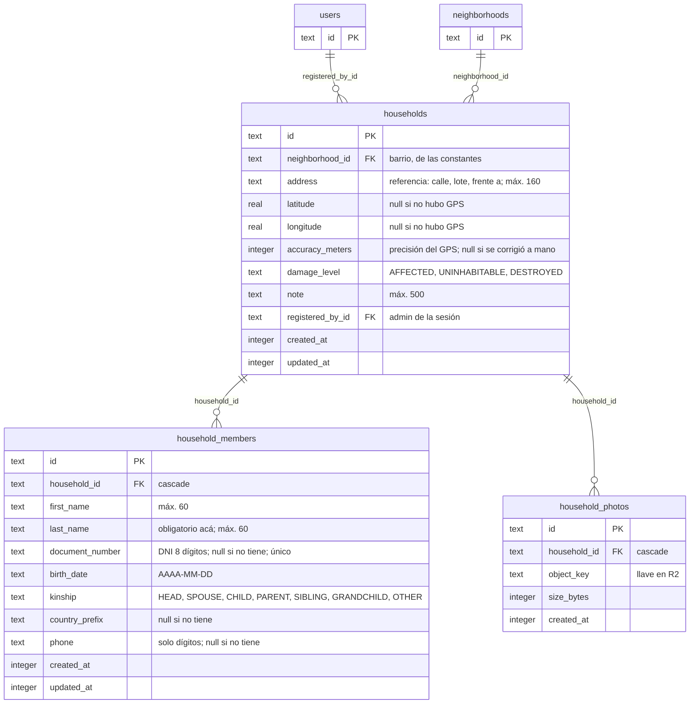

Ya leí el contexto y el código clave (esquema, rutas, formularios, navegación, wrangler). Ahora redacto la propuesta.

# Propuesta: empadronamiento de viviendas afectadas por lluvias

## 1. Entendimiento

Un admin, desde el celular en la calle, registra cada vivienda dañada: GPS, barrio, referencia, nivel de daño, 1–2 fotos y sus habitantes (nombres, DNI, nacimiento, parentesco con el jefe de hogar). Luego se consulta en la app (lista filtrable, detalle con fotos y ubicación) y se exporta un Excel para las autoridades. Las tablas deben servir de base al censo por familias sin rehacerse.

## 2. Lo que ya hay

Verificado leyendo el repo:

- **Esquema y migraciones**: `packages/db/src/schema/*` con `timestamps()` de `columns.ts`, PK UUID v7 (`lib/ids.ts`), migraciones con `pnpm db:generate`. `activity-teams.ts` muestra el patrón padre + hijos con `onDelete: "cascade"` y escritura en `db.batch`.
- **Barrios**: constantes en `packages/shared/src/neighborhoods.ts` + tabla para la FK; `neighborhoodIdSchema` en `lib/person-input.ts` valida contra las constantes.
- **Validación**: `validateJson`, `optionalText`/`noteSchema` en `person-input.ts`; mensajes en español; `isIsoDate` en `shared/dates.ts`.
- **Conflictos con nombre**: `person-guards.ts` responde 409 con ««Ana» ya tiene ese número». Mismo patrón para el DNI.
- **Teléfono**: `phoneSchema` + `toPhoneColumns`/`toPhoneResource` (`lib/phone-input.ts`), `PhoneInput` en el front.
- **Front**: `PageContainer`, `PageBox isFill`, `Loadable`, `Modal` con `isDirty`, `FormSubmitButtons` con «Crear y seguir creando», `OptionCards` (3 opciones con ícono), `NeighborhoodBadge`, `FiltersModal`/`FilterButton`, `StickyToolbar`, `SearchInput`, `usePagination`, `useRequest` con `onUpsert`/`onRemove`, `parseWrittenDate` exportada en `date-input.tsx`.
- **Páginas de detalle como ruta** (`proyectos.$projectId.tsx`), lista que navega al crear (`onSaved={openProject}`).
- **Navegación tipada** en `common/constants/routes.ts` (`TNavPath`).
- **Cloudflare**: `env` de `cloudflare:workers` tipado en `packages/env/env.d.ts`; bindings en `apps/server/wrangler.jsonc`. No hay R2 ni ninguna librería de Excel hoy; `apiRequest` solo manda JSON.

## 3. Preguntas que cambiarían el diseño

1. **Sectores fuera de los 5 barrios.** Propongo `neighborhood_id` obligatorio y agregar los sectores afectados en una migración antes del slice 1 (Thony pregunta a las autoridades la lista). Si no se puede saber de antemano, el campo pasa a nulo con un texto libre `sector`, y los filtros ganan «Sin barrio».
2. **¿El daño es de esta lluvia o de la vivienda?** Propongo guardarlo en la vivienda (una emergencia). Si Juveco va a empadronar más de una emergencia sobre las mismas casas, el daño y las fotos van en una tabla `household_damage_reports` desde el inicio. Decidirlo ahora cuesta nada; después cuesta una migración con copia de datos.

## 4. Alcance de la fase 1 y qué queda para después

**Fase 1**: vivienda (GPS, barrio, referencia, daño, nota), habitantes (nombres, apellidos, DNI, nacimiento, parentesco, teléfono opcional), 2 fotos, lista con filtros, detalle, Excel. Quién empadronó y cuándo sale de la sesión.

**Después**: material y tenencia, gestante/discapacidad (menores y adultos mayores salen de la fecha de nacimiento, no se guardan), mapa dentro de la app, modo sin señal, encuesta social, enlace opcional entre un habitante y un `user`.

**¿Bastaría un Excel?** Para la fila por persona, sí. Lo que una hoja compartida no da bien con varias personas en la calle: fotos ligadas a la vivienda, GPS tomado del teléfono, aviso de DNI repetido y la base para el censo. Si el slice 1 y 2 no están en 2–3 días, el puente es una hoja con las mismas columnas del Excel exportado, y se carga a mano después.

## 5. Datos

**Decisión central: los habitantes van en tabla propia, no en `users`.** `users` es «personas de Juveco»: con WhatsApp único, rol, y se usa en `UserSearch`, compradores, donantes, jugadores y cobradores. Meter cientos de vecinos (con menores) ahí inflaría el buscador de compradores y la lista de Usuarios, mostraría DNI y nacimiento en pantallas que no son del padrón, y obligaría a columnas nulas para el 95 % de las filas. Con tabla propia: cero impacto en consultas actuales, los datos sensibles solo salen por las rutas del padrón, y el censo crece sobre `households`/`household_members`. Deuda aceptada: una persona puede existir en ambas tablas; se resuelve después con un `user_id` opcional si hace falta.

- **`damage_level`** como texto con enum `EDamageLevel` + `damageLevelLabels` en `packages/shared/src/households.ts`, igual que los roles. Etiquetas de arranque: Afectada / Inhabitable / Destruida (EDAN de INDECI). Renombrar es cambiar la etiqueta, sin migración.
- **`kinship`** incluye `HEAD`: el jefe de hogar es un parentesco más, no un booleano aparte. La API garantiza un solo `HEAD` por vivienda.
- **`document_number`** nulo permitido (bebés sin DNI). Índice único: SQLite deja varios `NULL`, como en `users_phone_uidx`. Se llama así y no `dni` por si después entra carnet de extranjería.
- **`latitude`/`longitude` nulos**: el GPS puede fallar bajo techo; se guarda la vivienda igual y se corrige desde el detalle. `accuracy_meters` dice cuánto confiar.
- **Teléfono** con las mismas dos columnas de `users`, para reusar `phoneSchema` y `PhoneInput`.
- **Fotos**: solo la llave de R2; la imagen vive en un bucket privado `juveco-photos` (binding `PHOTOS`). Guardar la foto en D1 como blob no va: D1 tiene límite por fila y encarece cada lectura.
- **Material y tenencia** no entran ahora: cuando lleguen son columnas nulas nuevas en `households`, sin tocar lo demás.

## 6. API

Todo con `requireAuth`, sobre `{success, data, error}`, en `routes/households.ts` y `routes/household-photos.ts`.

- `GET /households`: todas las viviendas con sus habitantes y la lista de fotos (ids), el barrio resuelto desde las constantes y quién registró. Se filtra en el front, como usuarios. Es la única consulta que devuelve DNI y nacimiento.
- `POST /households`: barrio, referencia, coordenadas, precisión, daño, nota. `registered_by_id` sale de la sesión. Devuelve la vivienda.
- `PATCH /households/:id`: los mismos campos, parciales.
- `DELETE /households/:id`: confirma en el front; borra habitantes y fotos (en R2 también).
- `POST /households/:id/members`: nombres, apellidos, DNI, nacimiento, parentesco, teléfono. Si el DNI existe responde 409 con «Juan Pérez ya está empadronado en la vivienda «Calle Lima, lote 4»». Si manda `HEAD` y ya hay uno, 409 con su nombre.
- `PATCH` / `DELETE /households/:id/members/:memberId`.
- `POST /households/:id/photos`: cuerpo crudo `image/jpeg` (no multipart), máximo 2 MB y 2 fotos por vivienda; guarda en R2 con llave `households/{id}/{photoId}.jpg`. Devuelve la foto. `apiRequest` gana una variante que manda un `Blob` sin JSON.
- `GET /households/:id/photos/:photoId`: el Worker lee de R2 y responde la imagen con `Cache-Control: private`. El bucket no es público: el `requireAuth` protege las fotos. El front la usa como `src` (la cookie viaja al mismo origen de la API).
- `DELETE /households/:id/photos/:photoId`.

El Excel no pasa por la API: el front ya tiene todo cargado.

## 7. Pantallas

Nueva entrada «Padrón» en la navegación (`/padron`), para ADMIN y SUPERADMIN.

**Lista `/padron`** (celular): barra fija con buscador (referencia, nombre o DNI de un habitante) y botón de filtros (daño, barrio). Arriba, tres contadores compactos por nivel de daño. Cards: referencia y badge del daño en el header; barrio, «4 habitantes», «2 fotos» y quién registró en el cuerpo. Botón flotante «Agregar». Escritorio: tabla con las mismas columnas y filtros en fila. Botón «Exportar Excel» junto al título.

**Modal de vivienda**: estado del daño con `OptionCards` (3), barrio, referencia, bloque de ubicación: al abrir pide el GPS y muestra «±12 m» con botón «Volver a tomar»; los dos campos numéricos se editan a mano; enlace «Ver en Google Maps» para confirmar. Nota al final. Al crear, navega al detalle.

**Detalle `/padron/$householdId`**: encabezado con referencia, badge del daño, barrio, botón editar (ícono con borde) y `⋯` con eliminar. Sección «Ubicación» con coordenadas y enlace a Google Maps. Sección «Fotos»: miniaturas, botón «Tomar foto» (`input capture="environment"`) mientras haya menos de 2. Sección «Habitantes»: cards con nombre, edad calculada, parentesco, DNI; «Agregar habitante» abre la modal.

**Modal de habitante**: nombres, apellidos, DNI (numérico, 8), nacimiento escrito «dd/mm/aaaa» (reusa `parseWrittenDate`), parentesco (el primero arranca en «Jefe de hogar», los siguientes en «Hijo/a»), teléfono opcional. «Crear y seguir creando» para la familia completa. Al escribir el DNI se compara contra la lista cargada: si ya existe, aviso con enlace «Ir a la vivienda» antes de guardar. El 409 del servidor cubre el caso de otra persona registrándolo a la vez: recarga la lista y muestra el mismo enlace.

**Fotos**: antes de subir se reducen en el navegador (lado mayor 1600 px, JPEG 0,8), de varios MB a 200–400 KB.

## 8. Slices

1. **Viviendas.** Migración con las tres tablas, constantes en `shared`, `households.ts` (API de vivienda), nav, lista con filtros y contadores, modal con GPS, detalle sin habitantes ni fotos. *Prueba*: desde el celular registrar una vivienda con GPS, corregir una coordenada, verla en la lista, filtrar por daño y barrio, abrir Google Maps desde el detalle.
2. **Habitantes.** Rutas de miembros, regla de un solo jefe, 409 por DNI, modal con «Crear y seguir», aviso local de DNI repetido, cards en el detalle, buscador por nombre/DNI. *Prueba*: cargar una familia de 4 seguida, intentar un DNI repetido en otra vivienda y llegar a la existente con el enlace, intentar un segundo jefe.
3. **Fotos.** Bucket R2 (Thony: `wrangler r2 bucket create juveco-photos`), binding en `wrangler.jsonc` y `env.d.ts`, rutas de fotos, variante de `apiRequest` para `Blob`, compresión en el navegador, galería y eliminar. *Prueba*: tomar 2 fotos con la cámara, ver que la tercera se rechaza, eliminar una, recargar y verlas.
4. **Excel.** Librería en el front (`write-excel-file`; si no convence al instalar, SheetJS), tres hojas: Personas (una fila por persona con los datos de su vivienda y enlace a Maps), Viviendas (una por vivienda con número de habitantes) y Resumen (conteo por nivel de daño). Exporta lo filtrado. *Prueba*: exportar, abrir en Excel, revisar tildes, fechas y conteos.

## 9. Riesgos

- **Señal irregular**: cada paso es una petición pequeña, y la vivienda ya existe antes de las fotos. Pero no hay cola sin conexión: si se cae la señal a medio camino, la persona repite el paso. Si en campo resulta insoportable, el siguiente ítem es guardar en local y reintentar.
- **Fotos por el Worker**: cada imagen pasa por la API en vez de servirse directo de R2. Con decenas de viviendas no importa; con miles habría que pasar a URLs firmadas.
- **Barrios obligatorios**: si aparece un sector no previsto, nadie registra hasta migrar. Es la pregunta 1.
- **Daño en la vivienda** y no en una tabla de reportes: lo más simple hoy, deuda si hay otra emergencia. Es la pregunta 2.
- **Edad de los menores en el Excel** va con fecha de nacimiento y DNI: el archivo sale de la app solo a mano y hacia las autoridades, pero una vez descargado no hay control. Vale decirlo a quien lo exporta.
- **Librería de Excel**: no está en el repo; la elección se confirma al instalar. Si ninguna convence, un CSV con BOM resuelve la hoja Personas y pierde las otras dos.
