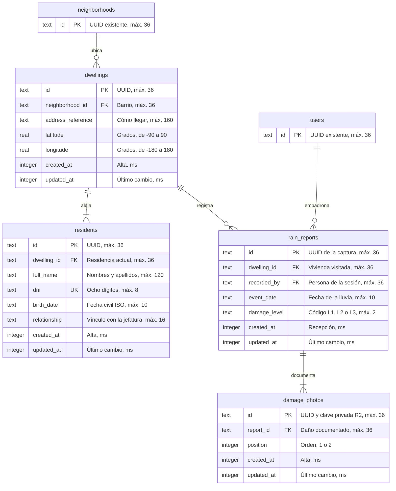

## Entendimiento

Juveco necesita saber a qué viviendas llevar ayuda y quiénes viven en ellas. Un `ADMIN` o `SUPERADMIN` debe poder empadronar desde el celular en menos de cinco minutos. La entrega será un Excel con una fila por habitante y un conteo por vivienda. La ubicación y los habitantes servirán también para el censo posterior.

## Lo que ya hay

- `users` reúne personas de Juveco. `auth_users` vincula su login. `GET /users` lista todo el directorio y `UserSearch` lo filtra en memoria para elegir compradores o jugadores. El esquema de `users` carece de DNI y nacimiento.
- `packages/shared/src/neighborhoods.ts` contiene cinco barrios con UUID fijos. Un sector nuevo requiere constante y migración. `roles.ts` ya separa los códigos de sus etiquetas.
- `requireAuth` comprueba la sesión y el rol. Las rutas de equipos muestran el patrón Hono, `validateJson` y `db.batch`. El cliente `apiRequest` envía la cookie y espera el sobre JSON del proyecto.
- La web ya tiene `PageContainer`, `PageBox`, `Loadable` y `FiltersModal`. El Worker tiene bindings D1. Falta conectar R2.

## Preguntas que cambiarían el diseño

- **¿Hay varias familias con jefaturas independientes bajo un techo?** Asumo una jefatura por vivienda para esta entrega. Si hay que distinguirlas ahora, agregaría `households` entre vivienda y habitante. El conteo de daños seguiría siendo por vivienda.
- **¿Se aceptan personas sin DNI?** Asumo ocho dígitos obligatorios, también para menores. Si la autoridad admite excepciones, harían falta identificación provisional y conciliación posterior. Un número inventado invalidaría el control de duplicados.

## Alcance de la fase 1 y qué queda para después

Incluye el episodio del 26/11/2026, GPS corregible, barrio, referencia, fotos, habitantes, consulta y Excel. Propongo «Afectada», «Muy afectada» e «Inhabitable». Thony podrá cambiar las etiquetas en `shared` conservando los códigos. El sistema toma empadronador y fecha automáticamente.

Quedan para después teléfono, observación, material, tenencia, gestación, discapacidad y encuesta social. Menores y adultos mayores pueden calcularse desde nacimiento a la fecha de interés.

Cabe en cuatro slices. Una hoja compartida serviría para una brigada única y una entrega puntual. Con varias brigadas, la app resuelve el choque de DNI al guardar, mantiene fotos y coordenadas junto a la vivienda y evita contar tres casas cuando una familia tiene tres integrantes.

## Datos

`dwellings` conserva el lugar. La FK permite filtrar por barrio, la referencia orienta al repartidor y las coordenadas abren el mapa. Dos casas vecinas pueden compartir coordenadas aproximadas. `rain_reports` separa el episodio del domicilio. La fecha del episodio viene de configuración. Vivienda y episodio forman una pareja única.

`residents` es una excepción deliberada a la convención de una sola tabla de personas. Incorporar damnificados a `users` ampliaría el directorio que cargan Usuarios y los selectores de actividades, incluidos los menores. El costo de separarlos es que alguien conocido por Juveco puede tener su nombre en ambos lugares. Las consultas actuales conservan su población. El censo podrá referenciar los UUID de vivienda y habitante.

El nombre completo reproduce el padrón. El DNI textual conserva ceros iniciales y su índice único resuelve altas simultáneas. Nacimiento admite fechas reales hasta hoy. El parentesco usa códigos para jefe, pareja, hijo, padre/madre, hermano, otro familiar u otro vínculo. La API exige exactamente un jefe y D1 limita a uno por vivienda con índice único parcial.

Cada foto tiene posición única dentro del informe. D1 conserva la relación y R2 el JPEG. Los UUID son v7. Los tiempos siguen `timestamps()`. Todos los textos de entrada llevan máximo en Zod. Thony genera las migraciones con `pnpm db:generate`.

## API

Bajo `/api/v1`, todas las rutas requieren `requireAuth` y devuelven respuestas privadas sin caché.

- `POST /rain-reports` recibe UUID de captura, ubicación, daño, habitantes y uno o dos JPEG comprimidos en base64. Máximo 350 000 bytes por imagen, 466 668 caracteres codificados. El Worker valida formato, firma, tamaño y campos antes de escribir. Base64 permite reutilizar `validateJson` a costa de más tráfico.
- El Worker sube fotos con claves nuevas por intento y confirma todas las filas en un `db.batch`. Devuelve la ficha creada. Ante respuesta perdida, el móvil repite la misma captura sin modificarla y recupera su confirmación. Si chocan dos escrituras, se comprueba primero la captura y luego el DNI. Un conflicto de DNI devuelve 409. Se eliminan los objetos de intentos fallidos y una tarea recoge los de más de 24 horas sin fila confirmada.
- `POST /residents/lookup` recibe los DNI del formulario en el cuerpo y devuelve coincidencias con habitante y ficha. Permite abrir el registro existente después de un 409 sin poner documentos en la URL.
- `GET /rain-reports` acepta barrio y estado opcionales y devuelve resúmenes del episodio. `GET /rain-reports/:id` entrega ubicación, habitantes y referencias a fotos. `GET /rain-reports/:id/photos/:position` comprueba la pertenencia y entrega JPEG privado, única excepción al sobre JSON.
- `GET /rain-reports/export` devuelve las filas del episodio completo. La web genera un `.xlsx` con «Personas» y «Resumen». Repite vivienda, barrio, referencia, coordenadas y daño por persona. Escribe DNI como texto y cuenta viviendas distintas por nivel, incluidos los niveles en cero.

## Pantallas

«Viviendas afectadas» aparece en la navegación privada. «Registrar» abre una columna en celular y dos en escritorio. Se toma el GPS al empezar. Si falla el permiso, se pueden escribir las coordenadas. La cámara muestra miniaturas, reduce las fotos antes del envío y permite repetirlas. Se carga primero al jefe y luego a los demás. Un corte conserva la ficha en memoria y ofrece «Reintentar».

La lista muestra cards con barrio, referencia y daño. Los filtros van en modal en celular. El detalle permite ver habitantes, ampliar o descargar fotos y abrir Google Maps con las coordenadas. «Exportar padrón completo» explicita el alcance. Cada página usa `PageContainer`, `PageBox isFill` y `Loadable` en la carga inicial.

## Slices

1. **Captura en celular.** Formulario, GPS y compresión quedan usables hasta la vista previa. En cinco minutos, Thony deniega GPS, corrige las coordenadas y toma dos fotos.
2. **Alta confirmada.** Conectar formulario, esquema D1, R2 y rutas de alta y coincidencias. En ocho minutos, registrar tres personas en menos de cinco, reintentar tras un corte y repetir un DNI desde otra sesión. Debe abrirse la ficha original.
3. **Consulta.** Conectar lista, filtros y detalle. En cinco minutos, combinar barrio y daño, abrir Maps y comprobar en incógnito que la URL de una foto exige sesión.
4. **Entrega.** Conectar exportación y descarga. En cinco minutos, abrir el Excel con una casa de tres habitantes. Deben aparecer tres filas, una vivienda en el resumen y el cero inicial del DNI.

## Riesgos

Cerrar la pestaña antes de confirmar pierde el borrador. La prueba de calle debe medir señal y tiempo real con familias numerosas. Dos brigadas podrían registrar la misma casa con habitantes distintos. Conviene repartir sectores. El Excel descargado queda fuera del control de acceso de la app.