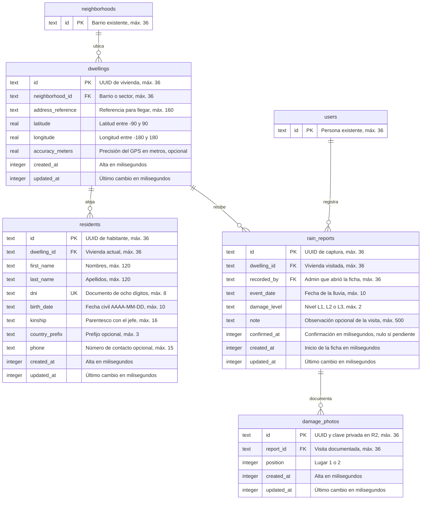

Se implementa en **4 slices** el padrón privado de viviendas afectadas por la lluvia del 26 de noviembre de 2026: ubicación, habitantes, evidencia del daño y Excel para el reparto.

## Lo que hay

- `requireAuth` admite a `ADMIN` y `SUPERADMIN`. La API usa `/api/v1`, valida los formularios con Zod y ya agrupa escrituras relacionadas con `db.batch`. [Permisos](apps/server/src/middleware/require-role.ts) · [Rutas de equipos](apps/server/src/routes/activity-teams.ts)
- `users` alimenta el directorio de Juveco y los selectores de personas. `GET /users` devuelve campos elegidos explícitamente y `UserSearch` filtra el directorio en memoria. El login está vinculado a la persona. [Usuarios](apps/server/src/routes/users.ts) · [Selector](apps/web/src/modules/users/components/user-search.tsx) · [Esquema de acceso](packages/db/src/schema/auth.ts)
- Hay cinco barrios con UUID fijos. Agregar un sector requiere actualizar las constantes y una migración. La web ya tiene el patrón de página privada con `PageContainer`, `PageBox isFill` y `Loadable`. [Barrios](packages/shared/src/neighborhoods.ts) · [Página de proyectos](apps/web/src/routes/_app/proyectos.index.tsx)
- El Worker tiene D1. Falta conectar R2. El cliente envía la cookie y procesa JSON. La web y la API usan orígenes distintos en producción. [Worker](apps/server/wrangler.jsonc) · [Cliente](apps/web/src/lib/api.ts)

## Lo que falta

Una brigada debe poder encontrar la casa, registrar a la familia y confirmar la visita en **menos de cinco minutos**. Si pierde señal, debe poder retomar lo guardado. La autoridad debe recibir solo viviendas completas, aunque haya visitas pendientes.

Una hoja compartida sirve como puente para una entrega inmediata. Con varias brigadas, la app aporta control de DNI al guardar, fotos ligadas a cada visita y un conteo por vivienda aunque allí vivan varias personas. La encuesta social, el material, la tenencia y las preguntas de vulnerabilidad quedan para otra fase.

## Datos

- **Vivienda.** Barrio y referencia orientan al repartidor. Las coordenadas abren Google Maps. Pueden quedar pendientes hasta confirmar. Una corrección manual borra la precisión atribuida al GPS. Las casas vecinas pueden compartir coordenadas aproximadas.
- **Habitante.** La tabla propia evita incorporar a los damnificados, incluidos menores, al directorio y a los selectores de actividades. El costo es que un vecino ya conocido por Juveco puede figurar en ambos registros. Nombres y apellidos separados permiten ordenar el Excel. El DNI textual conserva ceros iniciales. Su índice único cubre altas simultáneas. La fecha de nacimiento debe existir y ser anterior o igual a hoy. `HEAD` identifica al jefe dentro del parentesco. Un índice único parcial admite a lo sumo uno por vivienda. El teléfono del jefe sirve para coordinar la entrega.
- **Visita.** La pareja vivienda–fecha es única. El daño, la observación y las fotos pertenecen a esa lluvia. Otra lluvia podrá tener su propio informe. El censo podrá usar los mismos identificadores de vivienda y habitante. La fecha del episodio y las etiquetas viven en `shared`. El empadronador sale de la sesión.
- **Confirmación.** `confirmed_at` es la **adición de esta síntesis**. Permite guardar por pasos y distingue una visita interrumpida de una vivienda lista para reparto. Solo las fichas confirmadas alimentan conteos y Excel.
- **Foto e identificadores.** D1 guarda la relación y reserva una posición única por informe. R2 guarda el JPEG. El celular asigna un UUID v7 estable a cada alta antes del envío. Repetir el mismo paso recupera lo guardado. Los tiempos registran altas y correcciones. Cada texto de entrada lleva su máximo en Zod.

## Lo que conlleva

### Slice 1: Guardar y retomar una vivienda

Crear `dwellings` y `rain_reports`. En «Padrón», el admin elige barrio y daño, escribe la referencia y toma el GPS. Ve la precisión, puede repetir la lectura, editar las coordenadas y abrir Maps. La API privada guarda vivienda e informe juntos. La lista de pendientes permite retomar, corregir o descartar la ficha con confirmación. Todas las pantallas nuevas usan los componentes comunes. La portada sigue siendo pública y ajena al padrón.

**Prueba manual · 5 min.** Crear una ficha desde el celular, cerrar y volver a «Pendientes». Corregir la ubicación y abrir Maps. Comprobar que hay una sola ficha y que todavía no suma al padrón.

### Slice 2: Registrar a la familia y resolver DNI repetidos

Agregar `residents` y las operaciones de alta, edición y eliminación desde la ficha. «Agregar y seguir» mantiene abierto el formulario. Se puede dejar el DNI pendiente durante la visita. `POST /residents/lookup` recibe el documento en el cuerpo. Si dos admins intentan guardarlo, D1 admite una sola alta. El otro recibe un 409 y el enlace «Ir a la vivienda». La jefatura se puede reasignar en una sola operación.

**Prueba manual · 6 min.** Cargar un jefe y dos familiares con «Agregar y seguir». Corregir un apellido. Desde otra ficha, repetir un DNI y abrir la vivienda indicada. Intentar agregar un segundo jefe y comprobar el rechazo.

### Slice 3: Confirmar el daño y consultar el padrón

Conectar el bucket R2 privado, `damage_photos` y la cámara. El celular reduce cada foto a JPEG de hasta 1600 px de lado mayor, parte de calidad 0,8 y envía el archivo binario por separado. El Worker valida formato y tamaño, con tope de 2 MB. Subir, reemplazar y eliminar fotos requiere sesión.

«Confirmar visita» comprueba en una operación de D1 ubicación válida, datos obligatorios de los habitantes, exactamente un jefe y una o dos fotos guardadas. Las ediciones posteriores conservan esos mínimos, incluso con dos admins operando a la vez. La lista filtra por daño y barrio en el servidor y devuelve resúmenes. El detalle carga habitantes, fotos y Maps. Las respuestas privadas se sirven sin caché.

**Prueba manual · 9 min.** Con señal de campo, cronometrar desde «Registrar» hasta confirmar una casa con cuatro personas y dos fotos. Debe tomar menos de cinco minutos. En una ficha pendiente del slice anterior, cortar la conexión tras enviar una foto y reintentar al volver: debe ocupar un solo cupo. Probar los filtros, intentar quitar la última foto de una ficha confirmada y abrir su URL en incógnito: debe exigir sesión.

### Slice 4: Entregar el Excel completo

«Exportar padrón completo» consulta el episodio confirmado por una ruta privada. La web genera el `.xlsx` con tres hojas. **Personas** repite vivienda, barrio, referencia, coordenadas y daño por cada habitante, junto a nombre, DNI textual, nacimiento y parentesco. **Viviendas** da una fila por destino con Maps, contacto y número de habitantes. **Resumen** cuenta viviendas distintas por nivel e incluye los niveles con cero.

**Prueba manual · 4 min.** Con dos viviendas confirmadas de barrios distintos y una pendiente, filtrar por un barrio y exportar. Deben salir ambos destinos confirmados, una fila por habitante, el cero inicial del DNI y un total de dos viviendas.

## Riesgos

- Dos brigadas pueden registrar la misma casa con habitantes distintos. Conviene repartir los sectores. Sin señal, el último paso sin enviar puede perderse al cerrar la pestaña. Los pasos ya guardados se recuperan.
- Un corte entre R2 y D1 puede dejar un JPEG sin ficha. Se intenta borrar el objeto fallido. Queda como riesgo residual, sin limpieza programada en esta fase.
- Un Excel descargado contiene datos de menores y puede reenviarse. La sesión protege la descarga. Después, la custodia corresponde a quien recibe el archivo.

## Desacuerdos para Thony

| Tema | Claude propone | Codex propone | Mi recomendación y por qué |
|---|---|---|---|
| Personas sin DNI | Admitir DNI nulo. | Exigir ocho dígitos. | Guardar a la persona en la ficha pendiente. Exigir DNI al confirmar mientras la autoridad lo pida. Si acepta excepciones, acordar cómo identificar y conciliar esos casos antes de la entrega. |
| Alcance del Excel | Exportar lo filtrado. | Exportar el episodio completo. | Entregar el completo con el alcance escrito en el botón. Un filtro olvidado podría dejar a un barrio sin reparto. |
| Contacto y observación | Incluir ambos. | Diferir ambos. | Incluirlos como opcionales. El teléfono permite coordinar la entrega y la nota recoge una indicación de la visita. |

## Preguntas abiertas

- **¿Qué niveles reconoce la autoridad?** Se asumen L1 «Afectada», L2 «Muy afectada» y L3 «Inhabitable». Confirmar las definiciones antes de clasificar la primera casa.
- **¿Qué sectores se visitarán?** Se asume que pueden enumerarse y agregarse al catálogo antes de salir. Un sector faltante impediría asignar correctamente la vivienda.
- **¿Hay familias con jefaturas independientes bajo un mismo techo?** Se asume una jefatura por vivienda. Si hay que distinguir varias, hace falta separar familia de vivienda y seguir contando el daño una sola vez por destino.