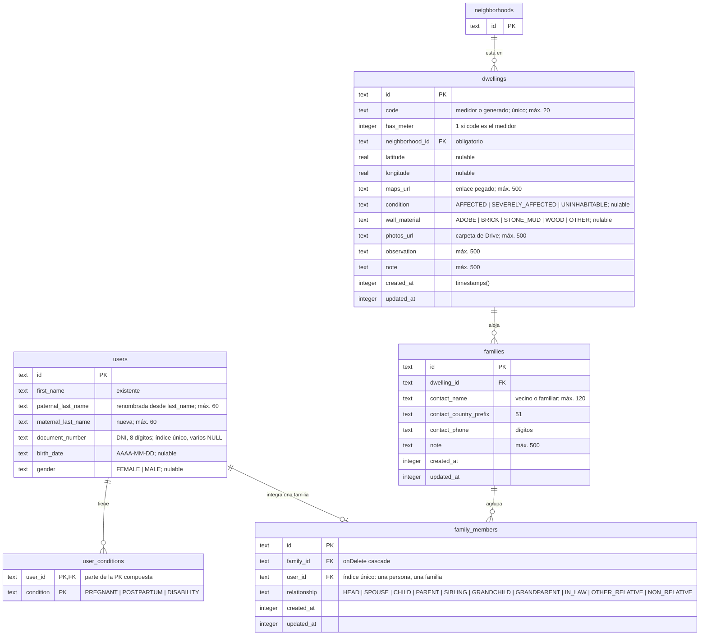

# Propuesta: empadronamiento (censo de viviendas, familias y personas)

## 1. Entendimiento

¿Se resuelve sin código? **No.** Un Excel compartido serviría para la lluvia, pero rompe las decisiones 1 y 6b (la persona censada es un usuario de la app, con DNI único) y el criterio 5 (campañas futuras colgadas de estas tablas). Se construye en la app, mínimo y genérico.

Se quiere un censo actual, sin historial: viviendas (código = medidor) con una o más familias, cada una con jefe de hogar y sus integrantes, que son usuarios. Se registra desde celular y escritorio, se consulta con filtros y se exporta a un `.xlsx` con celdas combinadas.

## 2. Lo que ya hay

Verificado leyendo el repo:

- `users` con `first_name`, `last_name` (uno solo), barrio, teléfono (`country_prefix` + `phone`, índice único), WhatsApp y nota. `fullName` en `people.ts` concatena nombre y apellido.
- `person-input.ts` (zod del servidor) y `person-form.ts` (zod del front) comparten las reglas de persona; `UserFormModal` es el único formulario de persona y lo abre `UserSearch` al «Crear «…»». Ese buscador filtra la lista ya cargada (`matchesUserSearch`).
- `person-guards.ts`: patrón `assertPhoneAvailable` que responde ««Ana» ya tiene ese número». Se copia para el DNI.
- `activity-teams.ts`: patrón de entidad con hijos (`activity_team_players` con `onDelete: cascade`, inserciones en `db.batch`, unicidad por índice y mensajes en español). Las familias y sus integrantes siguen ese molde.
- Barrios fijos en `shared/neighborhoods.ts` y `NeighborhoodBadge`.
- Enum + labels (`EActivityType` / `activityTypeLabels`) para opciones fijas.
- Página de lista completa (`usuarios.tsx`): `PageContainer`, `PageBox isFill`, `Loadable`, tabla en escritorio, cards y `StickyToolbar` con `FilterButton` en celular, `usePagination`, `ConfirmModal`.
- `dates.ts`: fechas ISO sin hora en hora de Lima. Ahí va `ageOn`.
- No hay ninguna librería de Excel en el monorepo.

## 3. Preguntas que cambiarían el diseño

1. **DNI, fecha de nacimiento y género: en `users` o en tabla de detalle.** Propongo columnas nulables en `users`, no la tabla de detalle de la decisión 1. Razón: son 1:1 con la persona, viven y mueren con ella, y hoy `users` ya tiene columnas que no todos llenan (teléfono, barrio). Una tabla aparte obliga a un `leftJoin` en cada búsqueda y en el guard de DNI único, sin ganar nada. Solo las **condiciones** (N por persona) van en tabla propia. Si Thony mantiene la tabla de detalle, cambian el esquema y dos consultas; API y pantallas quedan iguales.
2. **Vivienda sin daño.** Los 3 niveles son todos de afectación. Propongo que el estado sea nulable y `null` se muestre como «Sin daño». Si se prefiere un cuarto valor explícito, es una constante más.

## 4. Alcance de la fase 1 y qué queda para después

Fase 1: apellidos separados, datos de identidad y condiciones en la persona, viviendas, familias e integrantes, lista con filtros, detalle y Excel.

Después, sin tocar estas tablas: encuesta social (tabla de respuestas por vivienda), campañas de ayuda (tabla `campaign_deliveries` apuntando a vivienda, familia o persona), historial, fotos, modo sin señal, flujo de re-censo.

## 5. Datos

**Apellidos.** La migración renombra `last_name` a `paternal_last_name` y agrega `maternal_last_name`. Lo que ya está queda entero en el paterno: no se parte por espacios porque «De la Cruz Ruiz» se partiría mal. Son pocos usuarios y se corrigen al censarlos. `fullName` pasa a unir los tres. Cambia `IPersonInput`, los recursos que exponen `lastName` (`users`, `me`, `IActivityTeamPerson`, `collector`), el `orderBy` de jugadores y los tests. Es la deuda que se paga en el slice 1 y no vuelve.

**DNI** único con índice parcial sobre no nulos. Sin DNI no choca. **Edad** se calcula con `ageOn(birthDate, todayInLima())`; nunca se guarda. **Género** nulable: no bloquea.

**Condiciones** en tabla propia, PK compuesta: ampliar es agregar una constante al enum, y el resumen del Excel cuenta por condición con un `group by`.

**Vivienda.** `code` único es la identidad humana. Si no hay medidor, la API genera `<prefijo>-<correlativo>`: el prefijo se agrega a `INeighborhood` (`SR`, `RC`, `MA`, `EP`, `NE`) y el correlativo es el mayor sufijo existente de ese prefijo más uno, calculado al guardar. Si dos admins chocan, el índice único lo frena y la API reintenta una vez. Coordenadas y enlace van los dos: el enlace de WhatsApp (`maps.app.goo.gl`) no trae coordenadas, y las coordenadas del GPS del celular sirven aunque nadie pegue enlace.

**Familia sin `head_id`.** El jefe es el integrante con `relationship = HEAD`, con índice único parcial por familia. Una sola verdad: cambiar al jefe es actualizar dos filas en un `batch` (primero el antiguo recibe su nuevo parentesco, luego el nuevo pasa a `HEAD`). El nombre de la familia no se guarda: «Familia Quispe Mamani» sale de los apellidos del jefe.

**Contacto.** El teléfono de contacto es el del jefe (ya en `users`). Si no tiene, `contact_name` + teléfono de vecino o familiar en `families`. «Sin contacto» no se guarda: es jefe sin teléfono y sin contacto, calculado en el recurso, como la deuda de las cartillas.

**Prioridad** tampoco se guarda. En `shared/families.ts`: menor de `YOUNG_CHILD_MAX_AGE` (5), mayor de `ELDER_MIN_AGE` (60) o cualquier condición. El recurso devuelve `priorityReasons: string[]`; vacío es sin prioridad. Lista, filtro y Excel leen lo mismo.

**Una persona en dos familias** la impide el índice único de `family_members.user_id`; el mensaje dice en qué familia y vivienda está.

**Consultas actuales:** ninguna se rompe salvo las que leen `lastName`, enumeradas arriba.

## 6. API

Todo con `requireAuth`, sobre `{success, data, error}` y `validateJson`.

- `GET /users`, `POST`, `PATCH`: suman `paternalLastName`, `maternalLastName`, `documentNumber`, `birthDate`, `gender`, `conditions: string[]`. Guard `assertDocumentAvailable` responde ««Ana Quispe» ya tiene ese DNI».
- `GET /dwellings`: lista con barrio, estado, conteo de familias y personas, `priorityReasons` y `hasNoContact` por vivienda.
- `GET /dwellings/:id`: la vivienda con sus familias y, en cada una, el jefe primero y los integrantes con parentesco, edad, DNI y condiciones.
- `POST /dwellings` (sin `code` cuando no hay medidor: la API lo genera y lo devuelve), `PATCH /dwellings/:id`, `DELETE` solo si no tiene familias.
- `POST /dwellings/:id/families`: `{ headId, contactName?, contactPhone?, note? }`. Crea la familia y al jefe como integrante `HEAD`.
- `PATCH /dwellings/:id/families/:familyId` (contacto y nota), `DELETE` (borra integrantes por cascada, nunca a las personas).
- `POST /dwellings/:id/families/:familyId/members`: `{ userId, relationship }`. `PATCH .../members/:memberId` (parentesco). `DELETE` salvo el jefe.
- `POST /dwellings/:id/families/:familyId/head`: `{ userId, previousHeadRelationship }`. El nuevo jefe ya es integrante.
- `GET /dwellings/padron`: todas las viviendas anidadas, para el Excel.

## 7. Pantallas

Nueva entrada «Viviendas» en la navegación (`/viviendas`). Nada en la portada.

**Persona (`UserFormModal`, ya existe).** Apellido paterno y materno en la misma fila. Nueva sección separada con línea: DNI, fecha de nacimiento (`DateField`), género y condiciones (chips multi). Todo opcional. Al escribir un DNI que ya está en la lista cargada, aviso bajo el campo con «Ver persona» / «Usar esta persona». Sin DNI, mismo nombre y misma fecha de nacimiento: aviso amarillo, no bloquea. `matchesUserSearch` suma el DNI.

**Lista de viviendas.** Celular: cards con código a 18 px, barrio, badge de estado, «2 familias · 7 personas», badge «Prioritaria» y «Sin contacto» en rojo. Buscador y botón de filtros en la barra pegajosa; filtros: barrio, estado, prioridad, sin contacto. Escritorio: tabla y filtros en fila. Tocar abre el detalle.

**Nueva vivienda (modal `lg`).** Toggle «Tiene medidor»: con él, el número; sin él, el barrio elegido muestra «Se le asignará SR-0001» y al guardar un `ConfirmModal` lo repite. Luego barrio (recuerda el último, como la persona), botón «Usar mi ubicación» (GPS) y campo para pegar el enlace, estado, material, enlace de fotos, observación, nota al final.

**Detalle de vivienda (página).** Encabezado con código, barrio, estado, botones Maps y Fotos, editar. Cuerpo: una card por familia (header: «Familia Quispe Mamani», teléfono del jefe o del contacto, badge «Sin contacto»; cuerpo: integrantes con parentesco, edad y condiciones; el jefe primero). Acciones directas: agregar integrante, editar parentesco; en `⋯`: cambiar jefe, editar contacto, eliminar. Botón «Agregar familia» (flotante en celular).

**Agregar familia (modal).** `UserSearch` para el jefe (crea ahí mismo con el formulario de persona). Si el jefe no tiene teléfono aparece el bloque de contacto: nombre y teléfono, opcionales. Nota.

**Agregar integrante (modal).** `UserSearch` + parentesco. «Guardar y agregar otro» para los 5 hijos seguidos.

Flujo en celular: vivienda (1 modal) → familia con jefe (1) → integrantes (1 por persona). Cada paso guarda: si se corta la señal no se pierde lo anterior.

## 8. Slices

1. **Persona censable.** Migración de apellidos (Thony responde «rename» cuando `db:generate` pregunte), columnas nuevas, `user_conditions`, zod en ambos lados, guard de DNI, formulario con la sección nueva y avisos de duplicado, `ageOn`, `fullName` y todos los usos de `lastName`, tests. Prueba: editar un usuario, separar apellidos, ponerle DNI y fecha; crear otro con el mismo DNI y ver el aviso y el error; buscar por DNI.
2. **Viviendas.** Esquema, prefijos de barrio, generación de código, rutas, lista con filtros de barrio y estado, modal y detalle vacío. Prueba: crear una con medidor y una sin, ver la confirmación y `SR-0001`; crear otra sin medidor y ver `SR-0002`; filtrar; abrir Maps.
3. **Familias e integrantes.** Esquema, rutas, cards en el detalle, cambio de jefe, prioridad y sin contacto en lista y filtros. Prueba desde el celular: una vivienda con dos familias, un jefe sin teléfono con contacto de vecino, un bebé sin DNI, una gestante; ver «Prioritaria» y «Sin contacto»; intentar meter a la misma persona en la otra familia; cambiar al jefe.
4. **Excel.** `GET /dwellings/padron` y botón «Exportar» en la lista. Prueba: descargar, abrir en Excel, revisar hoja «Resumen» y una hoja por barrio con celdas combinadas y el jefe resaltado.

**Librería de Excel:** ExcelJS en el navegador, cargada con `import()` solo al exportar. Combina celdas y aplica negrita y relleno, que es lo que pide la decisión 16. SheetJS gratuito no escribe estilos; ExcelJS en el Worker depende de APIs de Node que Cloudflare no garantiza. El archivo se arma en el cliente con lo que ya trae el padrón y se descarga como `padron-samán-AAAA-MM-DD.xlsx`.

**Hoja de cada barrio:** vivienda combinada sobre sus filas, familia combinada sobre sus integrantes, jefe primero en negrita con teléfono; columnas de persona (nombres, apellidos, DNI, nacimiento, edad, parentesco, condiciones); al final estado, observación y motivos de prioridad. **Resumen:** viviendas por barrio y por estado, familias, personas, prioritarias y sin contacto.

## 9. Riesgos

- **El slice 1 es el más invasivo** por `lastName`: toca recursos, tests y la sesión. Si se demora, los slices 2 y 3 esperan. Se podría arrancar el 2 en paralelo porque no dependen del apellido.
- **El censo urgente va a pasar por datos a medias**: hojas de papel sin DNI ni fecha. Todo es opcional a propósito; el riesgo es que la prioridad salga «sin motivo» por falta de fecha de nacimiento. El Excel lo deja ver.
- **El correlativo generado** vive en el código, no en una secuencia: es correcto mientras nadie edite `code` a mano para parecerse a uno generado. Se valida que un `code` editado no use el patrón `XX-0000`.
- **Cambiar al jefe** deja parentescos que ya no describen al nuevo jefe. La modal lo avisa y Thony los corrige uno a uno; no se automatiza.
- **Lo que no me convence:** una modal por integrante son muchos toques para una familia de 8. Si en la prueba del slice 3 se siente lento, el siguiente paso es un formulario de familia con filas repetibles, sin cambiar la API.
- ExcelJS en el navegador pesa unos 300 KB: aceptable porque solo lo descarga quien exporta, pero hay que confirmar que Vite lo parte en su propio chunk.
