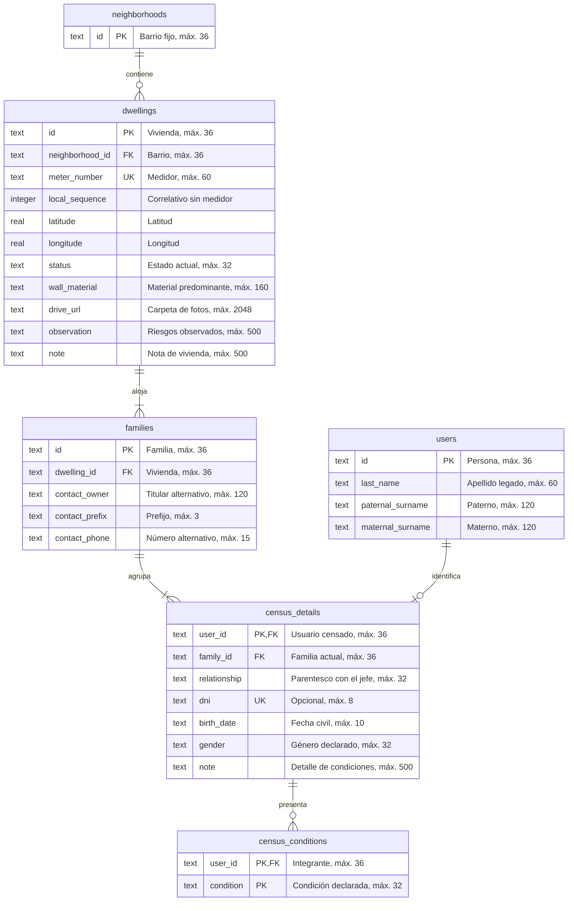

## Entendimiento

**No.** Una hoja permite recoger fichas hoy, pero el padrón debe reconocer a los usuarios existentes y evitar que dos admins asignen a la misma persona a familias distintas. La entrega mínima es un formulario en la app que guarda una vivienda completa. Después vienen la consulta para organizar las visitas y el Excel para entregar el padrón.

## Lo que ya hay

- `users` admite personas sin acceso, con apellido y teléfono opcionales. El teléfono propio es único por prefijo y número. La API ya comprueba duplicados y protege el borrado de usuarios vinculados a actividades. [Esquema de usuarios](/home/thony/own/juveco-saman/packages/db/src/schema/users.ts) · [Rutas de usuarios](/home/thony/own/juveco-saman/apps/server/src/routes/users.ts)
- `fullName` consume `lastName`. Equipos también lee y ordena por ese campo. `UserSearch` permite elegir con Enter y el formulario de usuarios ya ofrece «Crear y seguir creando». [Personas](/home/thony/own/juveco-saman/packages/shared/src/people.ts) · [Equipos](/home/thony/own/juveco-saman/apps/server/src/routes/activity-teams.ts) · [Selector](/home/thony/own/juveco-saman/apps/web/src/modules/users/components/user-search.tsx) · [Formulario](/home/thony/own/juveco-saman/apps/web/src/modules/users/components/user-form-modal.tsx)
- Los cinco barrios tienen identificadores fijos. Se reutilizan sus constantes, la validación de teléfonos y el patrón de escritura atómica `db.batch` de equipos. [Barrios](/home/thony/own/juveco-saman/packages/shared/src/neighborhoods.ts) · [Teléfonos](/home/thony/own/juveco-saman/packages/shared/src/phones.ts)

## Preguntas que cambiarían el diseño

¿Dos viviendas físicas pueden compartir medidor? Asumo que cada medidor identifica una sola vivienda, como decidió Thony. Si se confirma un medidor compartido, hará falta un código propio para distinguir las casas y el medidor pasará a ser una referencia compartida.

## Alcance de la fase 1 y qué queda para después

Alta de viviendas visitadas con al menos una familia, cambio de jefe, consulta privada y exportación completa. Papel y WhatsApp sirven como fuentes para transcribir. Quedan para después las encuestas sociales, campañas y entregas, historial, recenso, carga de fotos y captura sin señal. Las campañas podrán referenciar los identificadores estables de vivienda, familia o usuario.

## Datos

**Usuarios.** La migración generada con `pnpm db:generate` añade dos apellidos opcionales. El texto anterior se muestra íntegro hasta que un admin confirma la separación en Usuarios o al censar. Entonces se vacía el legado. Las lecturas de `lastName`, la búsqueda y la ordenación usan los apellidos confirmados o el legado. Así se conserva «De la Cruz» y cada comprador o jugador mantiene su ID. La deuda temporal es atender ambas formas de lectura.

**Vivienda.** Se guarda exactamente uno entre medidor y correlativo. El medidor conserva ceros iniciales. El correlativo es positivo y único por barrio. Los prefijos reservados son SR, RC, MA, EP y NE. Maps se abre con las coordenadas, que pueden repetirse. Drive admite una carpeta HTTPS opcional. Estado usa claves fijas con etiquetas «Afectada», «Muy afectada» e «Inhabitable». Observación y notas son opcionales. Al vincular un usuario, se confirma cualquier diferencia de barrio y se sincroniza `users.neighborhood_id` con la vivienda. Mientras resida allí, Usuarios remite el cambio de barrio al padrón.

**Familia.** `user_id` como PK del detalle impide pertenecer a dos familias. Un índice único por familia para el parentesco «Jefe» impide dos jefes. El alta exige uno. Para relevarlo, el admin elige un integrante y confirma todos los parentescos respecto del nuevo jefe en una sola escritura. El contacto sale del teléfono propio del jefe. Si falta, se piden juntos titular, prefijo y número alternativos, reutilizables entre familias. Si faltan ambos contactos, se muestra «Sin contacto».

**Persona y prioridad.** DNI admite ocho dígitos o nulo. La fecha de nacimiento usa `AAAA-MM-DD`. Una fecha desconocida deja la edad sin determinar. Cada condición ocupa una fila única por persona: gestante, parto reciente o discapacidad. Propongo prioridad familiar si algún integrante tiene menos de cinco años, tiene 60 cumplidos o presenta una condición. Lista y Excel aplican la misma regla a la fecha de consulta en Lima. Las nuevas tablas usan las marcas de tiempo comunes. Zod limita los textos. Las consultas ordinarias de usuarios siguen sin cargar datos censales.

## API

Todas las rutas del padrón exigen `requireAuth` para ADMIN o SUPERADMIN. Usan el sobre habitual, `validateJson` para los cuerpos y errores en español.

- `GET /dwellings/next-code` recibe barrio y devuelve el siguiente código para confirmación expresa. Si otro admin ocupa `SR-0001` entretanto, el alta devuelve conflicto y pide confirmar el nuevo código.
- `POST /census/matches` recibe DNI o nombres, apellidos y nacimiento. Devuelve coincidencias y acceso a su registro. Un DNI existente obliga a reutilizar la persona. Nombre completo normalizado y fecha iguales generan aviso y permiten confirmar un homónimo.
- `POST /dwellings` recibe vivienda, familias e integrantes nuevos o seleccionados por ID. Revalida duplicados dentro de la ficha y contra D1. Guarda todo en un lote y devuelve código e ID. Un conflicto de pertenencia identifica la ficha existente. Los nuevos usuarios tienen rol `USER`. La FK protege al censado frente al borrado desde Usuarios.
- `PATCH /families/:id/head` recibe el nuevo jefe, parentescos y contacto alternativo si corresponde. Devuelve la familia actualizada.
- `GET /dwellings` recibe filtros de barrio, estado y prioridad. Devuelve viviendas con conteos y familias sin contacto. `GET /dwellings/:id` devuelve la ficha completa. `GET /census/export` devuelve todo el padrón privado y su fecha de corte, independientemente de los filtros.

## Pantallas

En celular, una columna sigue el orden vivienda → jefe → integrantes → otra familia. Permite tomar coordenadas o escribirlas desde papel. El buscador reutiliza usuarios y mantiene las altas nuevas dentro de la ficha hasta guardar. En escritorio, modal ancha de dos columnas, navegación con Tab y «Guardar y registrar otra». La nota cierra el formulario.

La lista usa tarjetas en celular y tabla en escritorio. Muestra prioridad y «Sin contacto». El detalle abre Maps, Drive y el cambio de jefe. Las páginas usan `PageContainer`, `PageBox isFill` y `Loadable`. El padrón queda fuera de la portada y de la API pública.

## Slices

1. **Registrar.** Esquema, apellidos, API y formulario. Thony cronometra una ficha de dos familias con un comprador existente y un bebé sin DNI, una vez por dispositivo. Meta: menos de cinco minutos por ficha. Comprueba el nombre del comprador y la confirmación sin medidor.
2. **Consultar y cambiar jefe.** Lista, filtros, detalle y relevo. En cinco minutos, Thony filtra una vivienda prioritaria, abre Maps, cambia el jefe y verifica parentescos y contacto. Intenta asignar ese integrante a otra familia y abre la ficha indicada por el conflicto.
3. **Exportar.** ExcelJS se carga al exportar y genera el `.xlsx` en el navegador. Resumen por barrio y estado, con viviendas, familias, personas y familias prioritarias contadas una vez. Cada barrio tiene hoja, incluso vacío. Una fila por persona, vivienda y familia combinadas, jefe primero y resaltado, teléfonos, titular alternativo o «Sin contacto», nombres, apellidos, DNI como texto, nacimiento, edad, género, parentesco y condiciones. Estado y riesgos cierran cada fila. En cinco minutos, Thony exporta con un filtro activo y comprueba los cinco barrios, los totales y una vivienda con dos familias. [Documentación de ExcelJS](https://github.com/exceljs/exceljs#merged-cells)

## Riesgos

Las celdas combinadas dificultan filtrar integrantes en Excel. Repetiría código de vivienda y clave familiar en columnas auxiliares filtrables. Sin DNI, un homónimo requiere decisión humana. La prioridad por parto reciente puede quedar desactualizada entre visitas. El tiempo de captura queda pendiente de medir con una ficha real.