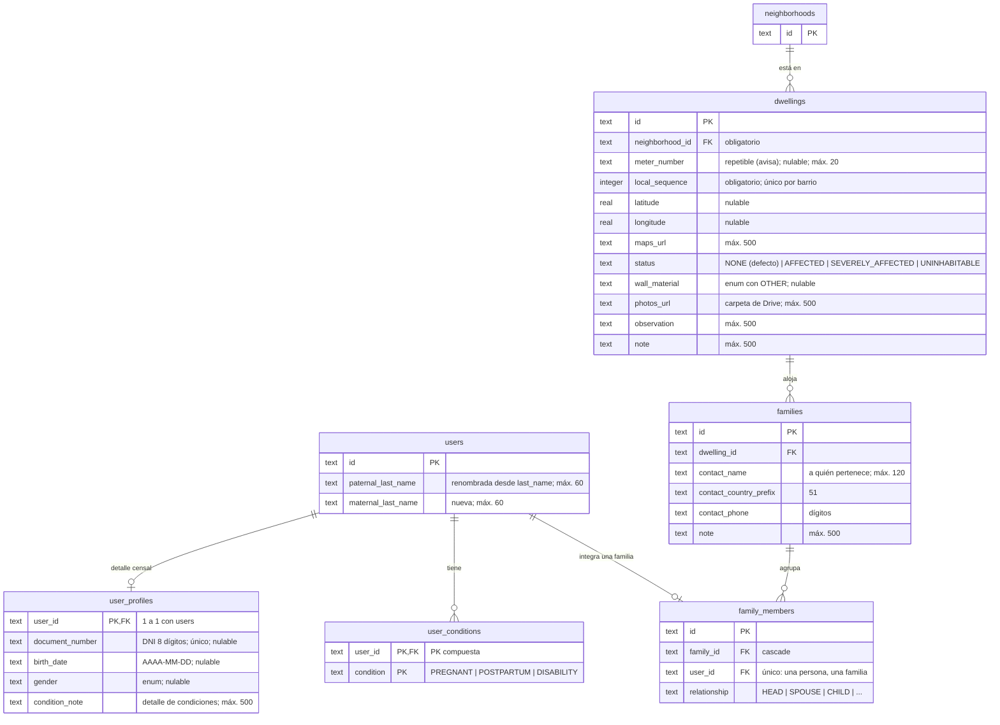

# Plan aprobado: empadronamiento

Aprobado por Thony el 2026-11-28.

## Decisiones de Thony al aprobar (mandan sobre el resto del documento)

1. **Apellidos existentes.** El campo actual se reparte así:
   - dos palabras: paterno y materno («Quispe Mamani» → Quispe / Mamani);
   - una palabra: paterno;
   - tres o más palabras («Del Rosario Castro»): todo queda como paterno, y Thony lo separa al censar.

   Es una migración de datos. Va en una migración propia generada con `drizzle-kit generate --custom`, nunca SQL suelto fuera de las migraciones. El implementador escribe su SQL y lo explica en el informe.
2. **Estado de la vivienda.** Tiene 4 opciones y no es nulable: **Sin daño** (por defecto), Afectada, Muy afectada e Inhabitable. Son constantes con etiqueta.
3. **Código de vivienda.**
   - Siempre lleva las **iniciales del barrio** y un correlativo por barrio: `SR-0001`, `RC-0001`…
   - El **número de medidor es un dato aparte**, opcional y **repetible**, porque es común que un medidor alimente a varias casas. Si se repite, la app avisa («este medidor ya está en SR-0003») y deja seguir.
   - Si se guarda sin medidor, pide confirmación, para que no se olvide por error.
   - Esto reemplaza la regla «medidor o correlativo, exactamente uno»: el correlativo siempre existe y es obligatorio.
4. **Edades de prioridad:** niños menores de 5 años y adultos de 60 o más.
5. **Género:** femenino o masculino, opcional.
6. **Material de paredes:** la lista del censo del INEI. Es decir, ladrillo o bloque de cemento, piedra o sillar con cal o cemento, adobe, tapia, quincha (caña con barro), piedra con barro, madera, triplay/calamina/estera y otro.
7. **Implementación:** mientras Codex no tenga créditos, implementa Sonnet y revisa Opus.

## Cambios tras probar el slice 2 (Thony, 2026-11-28; mandan sobre todo lo de abajo)

8. **Formulario de vivienda por pasos**, en lugar de uno largo. El paso actual se ve arriba con su número y nombre; «Siguiente» valida solo ese paso y «Atrás» no pierde nada.
   1. **Vivienda:** barrio, medidor, estado y material.
   2. **Ubicación:** un mapa Leaflet con vista satelital (Esri World Imagery) y de calles (OpenStreetMap), sin clave de API.
      - Abre centrado en Samán o en el GPS del celular, si se da permiso.
      - Se toca el mapa o se arrastra el pin hasta la casa exacta. Las coordenadas salen del pin.
      - Se quita el campo «enlace de Maps»: el botón «Abrir en Maps» se arma con las coordenadas.
   3. **Evidencias y notas:** las fotos (decisión 12), la observación y la nota.
9. **Material de paredes:** al lado de la etiqueta va un ícono (i) con tooltip (hover en escritorio, toque en celular): «Elige el material de las paredes. Si hay varios, el que más predomina». Con «Otro» aparece «Especifica el material», obligatorio, máx. 120.
10. **Se quita el enlace a la carpeta de Drive.** Las fotos se suben en el formulario (decisión 12).
11. **Formulario público, pendiente hasta aprobar.**
    - Lo puede llenar cualquiera sin cuenta: voluntarios o las mismas familias. Debe ser lo más intuitivo posible, pensado para el celular y para gente que no maneja bien la tecnología.
    - Pasos: Vivienda → Ubicación → Familias e integrantes → Fotos → «¿Quién llena?» (nombre y celular de quien envía) → Enviar.
    - Lo enviado **no toca** usuarios ni viviendas: queda como **solicitud pendiente**. Un admin la revisa y recién al aprobarla:
      - se crean la vivienda, sus familias y sus integrantes;
      - **el código se asigna al aprobar**, para que el spam no gaste correlativos.
    - **Al revisar,** cada persona con DNI que ya existe se muestra junto a la persona encontrada. Por defecto se vincula; el admin puede elegir crearla como nueva. El admin puede corregir antes de aprobar, o rechazar con motivo.
    - **El formulario público no revela nada de la base:** no hay avisos de DNI repetido ni buscadores de personas.
    - **Contra el abuso:** Cloudflare Turnstile (captcha gratuito y sin fricción), límite de envíos por IP y tope de tamaño en todo.
    - Lo pendiente no cuenta en listas ni en el Excel.
12. **Fotos en Google Drive por API**, con la cuenta Gmail personal de Thony. Una cuenta de servicio no sirve: no tiene espacio en un Drive personal.
    - **Autorización:** Thony la da una vez (OAuth) y el refresh token queda como secreto del Worker.
    - **Carpetas:** `Viviendas/<código> - Familia <apellidos del jefe>`. Mientras la solicitud está pendiente, las fotos van en `Viviendas/Pendientes/<id>`; al aprobarla, la carpeta se mueve y se renombra. Si cambia el jefe, se renombra.
    - **Subida:** las fotos se comprimen en el navegador antes de subir, a 1600 px de lado mayor y en JPEG. Máximo 5 por vivienda.
    - **Ver las fotos:** los archivos en Drive son privados. El admin los ve a través del servidor, nunca con un enlace público.
    - **Carpeta raíz por entorno:** su nombre sale de la variable `DRIVE_ROOT_FOLDER`, que por defecto es `Viviendas`. En local, `.dev.vars` usa `Viviendas (pruebas)` con las mismas credenciales. La app crea esa carpeta la primera vez (con `drive.file` no ve carpetas creadas a mano) y la busca por nombre entre las suyas.
14. **Integrantes primero, familias en segundo plano** (Thony, 2026-11-28). Casi toda vivienda tiene una sola familia, así que no se crea la familia antes que su gente:
    - **El detalle muestra «Integrantes»** como lista plana, con el jefe primero y marcado con ⭐. Solo si hay **más de una familia** se agrupa por familia, con el título «Familia <apellidos del jefe>».
    - **La acción primaria es «Agregar integrante».** El formulario trae los datos de la persona: se busca si ya está registrada o se llena ahí mismo.
      - Una estrellita marca «Es jefe(a) de hogar».
      - La familia se crea sola con el primer integrante. Una segunda familia se elige solo si hace falta, con un enlace discreto.
    - Desaparece el formulario «Agregar familia».
13. **Nuevo orden de trabajo** (el ítem creció; se pasa del tope de 4 slices):
    - **2 (ajuste):** diseño, pasos 1–3 sin fotos, mapa y material.
    - **2b:** formulario público con solicitudes y revisión.
    - **2c:** fotos a Drive.
    - **3 y 4:** sin cambios.
    - Los cambios de esquema van en una migración nueva, generada encima de la 0017.

---

Esta propuesta arma el empadronamiento genérico de viviendas, familias y personas en **4 slices**: persona censable, registro de viviendas con sus familias, consulta con filtros y cambio de jefe, y por último el padrón en Excel.

## Lo que hay

- **Un solo registro de personas** (Usuarios) con nombres, un único campo de apellidos, barrio, teléfono y nota. El teléfono ya no se puede repetir, y el sistema ya avisa «Ana ya tiene ese número». El aviso de DNI repetido se hace igual.
- **Un buscador de personas** que se usa en cartillas y equipos y que permite crear a la persona ahí mismo con el formulario de usuario. Ese formulario ya tiene «Crear y seguir creando». Sirve tal cual para elegir al jefe y a los integrantes.
- **Equipos con jugadores** ya resuelven el caso de un registro con hijos que se guardan juntos y se borran juntos. Familias e integrantes siguen ese mismo molde.
- **Los cinco barrios son fijos** y ya tienen su badge de color.
- Ya existen la página de lista completa (tabla en escritorio, cards y filtros en modal en celular, paginación), el panel lateral y la confirmación en modal.

Detalle técnico

- `packages/db/src/schema/users.ts`: `last_name` nulable. `GET /users` devuelve **todos** los usuarios y el front filtra en el navegador (`apps/web/src/modules/users/utils/user-search.ts`).
- `packages/shared/src/people.ts`: `fullName`, `PERSON_NAME_MAX_LENGTH = 60`, nota de persona 200.
- `lastName` se lee en `person-input.ts`, `routes/{users,me,activities,activity-finances,activity-teams}.ts`, `shared/activity-items.ts`, `person-form.ts`, `user-form-modal.tsx` y en 5 archivos de test.
- `apps/server/src/lib/person-guards.ts`: patrón `assertPhoneAvailable`.
- `packages/db/src/schema/activity-teams.ts`: jugadores con `onDelete: "cascade"` y escritura en `db.batch`.
- `packages/shared/src/neighborhoods.ts`: `INeighborhood { id, name }`, sin prefijos todavía.
- No hay ninguna librería de Excel en el monorepo.

## Lo que falta

- La persona no tiene apellido paterno y materno separados, ni DNI, ni fecha de nacimiento, ni género, ni condiciones de prioridad.
- No existe la vivienda: su código por medidor o generado, la ubicación, el estado, el material y la carpeta de fotos.
- No existe la familia, con su jefe, los parentescos y un contacto alternativo cuando el jefe no tiene teléfono.
- No se puede ver qué familias son prioritarias o están sin contacto, ni filtrar por eso.
- No se puede exportar un padrón con celdas combinadas.
- No hay aviso de persona repetida por DNI, ni por nombre y fecha de nacimiento.

## Datos

- **Apellidos.** El campo actual pasa entero a ser el apellido paterno, y se agrega el materno vacío. No se parte por espacios, porque «De la Cruz Ruiz» quedaría mal. A los pocos usuarios que hay se les corrige al censarlos.
- **Detalle de persona** (`user_profiles`). Guarda lo que no tienen todos los usuarios, como pide la decisión 1. Claude proponía ponerlo en `users` para ahorrarse un join. Me quedo con la tabla de detalle, por una razón que encontré en el código: hoy la lista completa de usuarios viaja al navegador cada vez que se abre un buscador de comprador o jugador. Con columnas en `users`, el DNI y la fecha de nacimiento de todo Samán viajarían en cada venta de cartilla. La tabla aparte deja esos datos solo en las pantallas del censo.
- **Condiciones.** Van en tabla propia, una fila por condición, para poder contarlas en el resumen. Sumar una condición nueva es sumar una constante.
- **Pertenencia separada de la identidad** (`family_members`). Codex juntaba DNI y familia en la misma fila. Así, sacar a alguien de su familia le borraría el DNI. Separadas, una persona puede quedar sin familia y conservar sus datos. El índice único sobre la persona impide que esté en dos familias.
- **El jefe** es el integrante con parentesco «Jefe», con un único jefe por familia. No hay una columna aparte de jefe: cambiarlo es actualizar dos filas. El nombre «Familia Quispe Mamani» sale de los apellidos del jefe.
- **Vivienda.** El medidor y el correlativo van en columnas separadas, y se guarda exactamente uno de los dos. Esto se toma de Codex. El código visible es el medidor, o el prefijo del barrio con el correlativo (`SR-0001`). Así se evita la regla frágil de Claude que impedía editar un código para que «no se parezca» a uno generado.
- **Material.** Es una lista fija con «Otro», no texto libre, para poder contarlo y filtrarlo.
- **Estado de la vivienda.** Es nulable. Ver preguntas abiertas.
- **Prioridad y «sin contacto» no se guardan.** Se calculan, igual que la deuda de las cartillas:
  - una familia es prioritaria si tiene un integrante menor de 5 años, uno de 60 o más, o alguna condición;
  - está sin contacto si el jefe no tiene teléfono y no hay contacto alternativo.
- **Las campañas futuras** se cuelgan de los identificadores de vivienda, familia o usuario sin tocar estas tablas.

Detalle técnico

- Los largos de apellido siguen en 60, como `PERSON_NAME_MAX_LENGTH` actual. Es una excepción ya existente a la regla de 120, que se mantiene por consistencia. Los enlaces van a 500, que es el largo de nota. El código de medidor va a 20.
- En SQLite un índice único admite varios `NULL`, así que el DNI no necesita índice parcial. Lo mismo aplica a `meter_number` y a `(neighborhood_id, local_sequence)`.
- Para el jefe hay un índice único parcial `family_members(family_id) WHERE relationship = 'HEAD'`.
- Hay un `CHECK` (o validación en la API): exactamente uno entre `meter_number` y `local_sequence`.
- `INeighborhood` suma `prefix` (`SR`, `RC`, `MA`, `EP`, `NE`) solo en la constante, no en la base.
- `ageOn(birthDate, today)` va en `shared/dates.ts`. Las reglas de prioridad van en `shared/families.ts`, con `YOUNG_CHILD_MAX_AGE = 5` y `ELDER_MIN_AGE = 60`. El recurso devuelve `priorityReasons: string[]` y `hasNoContact`.
- El usuario que integra una familia no se puede borrar desde Usuarios (FK sin cascade y mensaje en español), igual que una persona con cartillas.
- `timestamps()` en todas las tablas nuevas.

## Lo que conlleva

El registro va **por pasos que guardan**, como proponía Claude: vivienda, luego la familia con su jefe, luego los integrantes uno tras otro con «Guardar y agregar otro». Si se corta la señal en el campo, no se pierde lo ya guardado, y se reutilizan el buscador y el formulario de persona tal cual. Codex proponía una sola ficha que se guarda al final. Es más rápida si todo sale bien, pero lo pierde todo si algo falla, y además dejaba sin forma de editar nada después del alta.

### Slice 1: persona censable

**Qué queda usable.** El formulario de usuario muestra el apellido paterno y el materno en la misma fila. Debajo, separada por una línea, hay una sección opcional con DNI, fecha de nacimiento, género, condiciones (chips de selección múltiple) y el detalle de las condiciones.
- Si se escribe un DNI que ya existe, el campo avisa con «Ver persona» y no deja guardar.
- Si no hay DNI y ya existe alguien con el mismo nombre y la misma fecha de nacimiento, sale un aviso amarillo que no bloquea.
- El buscador también encuentra por DNI.

**Cómo lo prueba Thony.**
1. Edita un usuario existente y separa sus apellidos.
2. Le pone DNI y fecha de nacimiento.
3. Crea otro usuario con el mismo DNI: ve el aviso y el error.
4. Crea un bebé sin DNI con el mismo nombre y fecha que otro: ve el aviso amarillo y guarda.
5. Busca a alguien por su DNI.
6. Abre cartillas y equipos y comprueba que los nombres se ven completos.

Detalle técnico

- Migración con `pnpm db:generate`: **cuando pregunte, hay que elegir «rename»** para `last_name` → `paternal_last_name`. Si se elige crear y borrar, se pierden los apellidos.
- `fullName` une los tres campos. Se cambian todos los usos de `lastName` listados en «Lo que hay», el `orderBy` de jugadores, la portada pública y los tests.
- `POST/PATCH /users` aceptan `details` opcional (`documentNumber`, `birthDate`, `gender`, `conditions[]`, `conditionNote`) y lo guardan en `db.batch` con el usuario.
- `GET /users` **no** trae el detalle. `GET /users/:id` sí lo trae, y el formulario de edición lo pide al abrir.
- `GET /users/matches?documentNumber=` o `?firstName=&paternalLastName=&birthDate=`: búsqueda de duplicados en el servidor (tomado de Codex), que no depende de la lista cargada.
- Guard `assertDocumentAvailable`, que responde «“Ana Quispe” ya tiene ese DNI».

### Slice 2: registrar viviendas con sus familias e integrantes

**Qué queda usable.** Aparece la entrada «Viviendas» en el menú, con una lista simple (sin filtros) y el botón «Nueva vivienda».

- **Al crear una vivienda** (decisión 3 de Thony):
  - El código es **siempre** las iniciales del barrio más el correlativo de ese barrio. Al elegir el barrio aparece «Se le asignará SR-0001», y al guardar una confirmación lo repite.
  - El medidor es un campo aparte, opcional. Si ese número ya está en otra vivienda, avisa «ya está en SR-0003» sin bloquear (varias casas comparten medidor).
  - Si se guarda sin medidor, la confirmación lo advierte.
  - Después vienen barrio, «Usar mi ubicación» (GPS del celular) o las coordenadas escritas a mano, el enlace de Maps pegado, estado, material, enlace a la carpeta de fotos, observación y la nota al final.
- **El detalle de la vivienda** es una página: código, barrio, estado y botones de Maps y de Fotos. Debajo va una card por familia, con el jefe primero y los integrantes con su parentesco, edad y condiciones.
- **Agregar familia:** se elige o se crea al jefe. Si el jefe no tiene teléfono, aparece el bloque de contacto alternativo (a quién pertenece y número).
- **Agregar integrante:** buscador más parentesco, con «Guardar y agregar otro».
- **Ediciones:** se puede editar la vivienda, el contacto y el parentesco, y quitar a un integrante (salvo al jefe).

**Cómo lo prueba Thony**, cronometrando en el celular y luego en escritorio:
1. Registra una vivienda con medidor en Santa Rosa: ve la confirmación con `SR-0001`.
2. Registra otra con el mismo medidor: ve el aviso «ya está en SR-0001» y queda como `SR-0002`. Una tercera sin medidor: la confirmación lo advierte.
3. En una de ellas carga dos familias: una con un comprador del bingo como jefe y otra con un jefe sin teléfono y el contacto de un vecino, más un bebé sin DNI.
4. Intenta meter a la misma persona en la otra familia: ve el error que dice dónde está.
5. Meta: menos de 5 minutos por vivienda.

Detalle técnico

- `GET /dwellings/next-code?neighborhoodId=` devuelve el código siguiente (tomado de Codex). `POST /dwellings` recibe `expectedCode`. Si otro admin lo ocupó mientras tanto, la API responde 409 con el código nuevo y el front vuelve a confirmar.
- `GET /dwellings`, `GET /dwellings/:id`, `PATCH /dwellings/:id` y `DELETE /dwellings/:id` (este último solo si no tiene familias).
- `POST /dwellings/:id/families` con `{ headId, contactName?, contactPhone?, note? }`: crea la familia y al jefe como `HEAD` en un batch. También `PATCH` y `DELETE` (borra a los integrantes por cascada, nunca a las personas).
- `POST .../families/:familyId/members` con `{ userId, relationship }`, más `PATCH` y `DELETE` (salvo el jefe).
- Páginas con `PageContainer`, `PageBox isFill` y `Loadable`, con un esqueleto de cards y de tabla. Ruta `/viviendas` y `/viviendas/$dwellingId`.
- Todo con `requireAuth`. Nada en `/public`.

### Slice 3: consultar y cambiar al jefe

**Qué queda usable.**
- La lista filtra por barrio, estado, prioridad y «sin contacto», y busca por código o por nombre del jefe.
- Cada vivienda muestra «2 familias · 7 personas» y los badges «Prioritaria» (con sus motivos en el detalle) y «Sin contacto» en rojo.
- En el detalle, «Cambiar jefe» está en el menú `⋯` de la familia. Se elige a un integrante y se dice qué parentesco pasa a tener el jefe anterior. La modal avisa que los demás parentescos pueden necesitar corrección.

**Cómo lo prueba Thony.**
1. Marca a una integrante como gestante y filtra «Prioritaria»: aparece su vivienda.
2. Filtra «Sin contacto»: aparece la familia del jefe sin teléfono y sin vecino.
3. Abre Maps desde el detalle.
4. Cambia al jefe de una familia y comprueba que el nuevo va primero y que el teléfono de contacto cambió.

Detalle técnico

- `GET /dwellings` con filtros `neighborhoodId`, `status`, `isPriority` y `hasNoContact`. La prioridad se calcula en el recurso con la fecha de hoy en Lima.
- `POST .../families/:familyId/head` con `{ userId, previousHeadRelationship }`, que actualiza dos filas en `db.batch`: primero el jefe anterior y luego el nuevo.
- En escritorio, los filtros van en una fila bajo el encabezado. En celular, van en `FilterButton` con su modal.

### Slice 4: padrón en Excel

**Qué queda usable.** El botón «Exportar» en la lista descarga `padron-saman-AAAA-MM-DD.xlsx` con **todo** el padrón, aunque haya filtros activos.
- **Hoja «Resumen»:** viviendas por barrio y por estado, familias, personas, familias prioritarias y sin contacto.
- **Una hoja por barrio**, aunque esté vacía, con una fila por persona:
  - la vivienda combinada sobre todas sus filas y la familia combinada sobre sus integrantes;
  - el jefe primero, resaltado y con su teléfono (o el contacto alternativo, o «Sin contacto»);
  - después nombres, apellidos, DNI como texto, nacimiento, edad, género, parentesco y condiciones;
  - al final, estado de la vivienda, observación y motivos de prioridad.
- Para poder filtrar en el mismo Excel, cada fila repite el código de vivienda y el jefe de la familia en columnas auxiliares sin combinar (tomado de Codex).

**Cómo lo prueba Thony.**
1. Exporta con un filtro activo.
2. Comprueba que salen los cinco barrios y que los totales del resumen cuadran con la lista.
3. Revisa una vivienda con dos familias, con las celdas bien combinadas y el jefe resaltado.
4. Filtra por código de vivienda en la columna auxiliar.

Detalle técnico

- `GET /dwellings/export`: todas las viviendas anidadas con familias, integrantes y detalle. Se declara antes de `/:id`.
- La librería es **ExcelJS en el navegador**, cargada con `import()` solo al exportar, y Vite la deja en un chunk propio (unos 300 KB). Combina celdas y aplica estilos. SheetJS gratuito no escribe estilos, y ExcelJS en el Worker depende de APIs de Node.
- El DNI va con formato de texto para no perder los ceros iniciales.

## Riesgos

- **El slice 1 toca nombres en toda la app** (cartillas, equipos, portada, sesión, tests). Si en la migración se elige mal la opción «rename», se pierden los apellidos actuales. Conviene respaldar la base de producción antes.
- **El slice 2 es el más grande**, porque concentra el registro entero para que la data urgente pueda empezar a cargarse en cuanto termine.
- **Una modal por integrante** puede sentirse lenta con familias de 8. Si la prueba del slice 2 pasa de los 5 minutos, el siguiente paso es un formulario de familia con filas repetibles, sin cambiar la API.
- **Datos a medias:** sin fecha de nacimiento, la edad no se calcula y una familia con un bebé puede no salir como prioritaria. El Excel muestra la edad vacía para que se note.
- **«Dio a luz recientemente»** se desactualiza sola entre visitas. Nadie la apaga.
- **Al cambiar al jefe**, los parentescos de los demás quedan descritos respecto al jefe anterior hasta que alguien los corrija.
- **Las celdas combinadas** se rompen si alguien reordena la hoja. Para eso están las columnas auxiliares.

## Desacuerdos para Thony

| Tema | Claude propone | Codex propone | Mi recomendación y por qué |
|---|---|---|---|
| Dónde van DNI, fecha de nacimiento y género | Columnas en `users` | Tabla de detalle | **Tabla de detalle**, como decidió Thony. Además, hoy la lista entera de usuarios viaja al navegador en cada buscador, y con columnas en `users` llevaría datos sensibles a cada venta de cartilla. |
| Apellidos existentes | Renombrar a paterno y listo | Conservar el campo viejo hasta que un admin «confirme» la separación | **Renombrar.** Un solo cambio con fin claro. Conservar el campo viejo obliga a leer dos formas en cada consulta sin fecha de término. |
| Forma del registro | Por pasos que guardan | Una ficha completa en un solo guardado | **Por pasos.** No pierde nada si se cae la señal, reutiliza lo que existe y deja editar después. |
| Barrio del usuario | No tocarlo | Sincronizarlo con la vivienda y bloquear su cambio en Usuarios | **No tocarlo.** El ítem no lo pide y agrega una confirmación al alta urgente. |
| Cantidad y orden de slices | 4 (persona, viviendas con lista, familias, Excel) | 3 (registrar, consultar, exportar) | **4 en el orden del ítem:** persona, registro completo, consulta, Excel. Aísla el cambio de apellidos y deja usable el registro antes que los filtros. |

## Preguntas abiertas

1. **¿Una vivienda puede no tener daño?** Se registran todas las viviendas donde hay alguien, pero los 3 estados son de afectación. *Supuesto:* el estado queda vacío y se muestra «Sin daño».
2. **¿Desde qué edad es «niño pequeño» y desde cuál «adulto mayor»?** *Supuesto:* menor de 5 años y 60 o más. Son constantes y se cambian en un solo lugar.
3. **¿Dos casas pueden compartir medidor?** *Supuesto:* no. Un medidor identifica una sola vivienda y el sistema rechaza el repetido.
4. **¿Qué opciones de género?** *Supuesto:* femenino y masculino, opcional.
5. **¿Qué materiales de pared?** *Supuesto:* adobe, ladrillo, piedra con barro, madera y otro. Se amplía con una constante.
