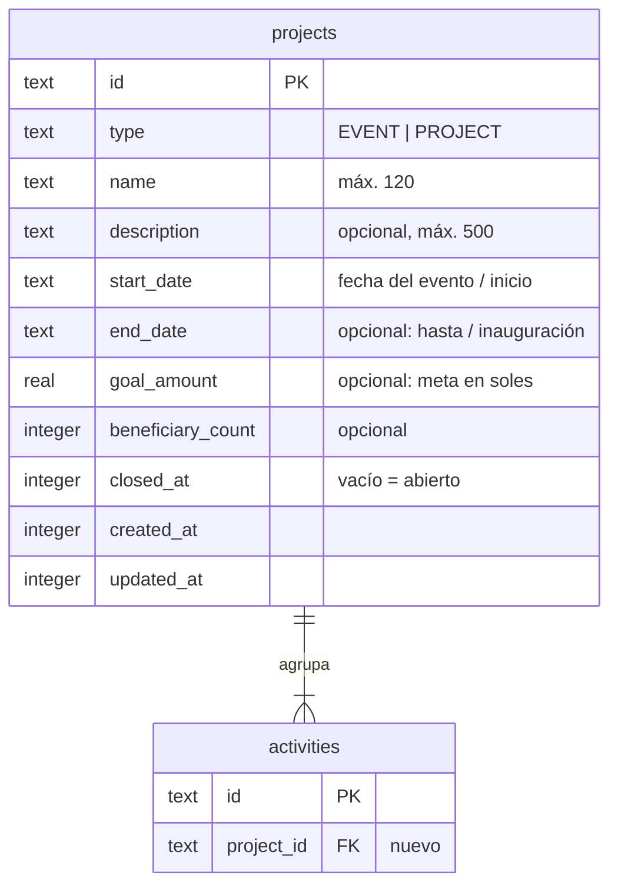
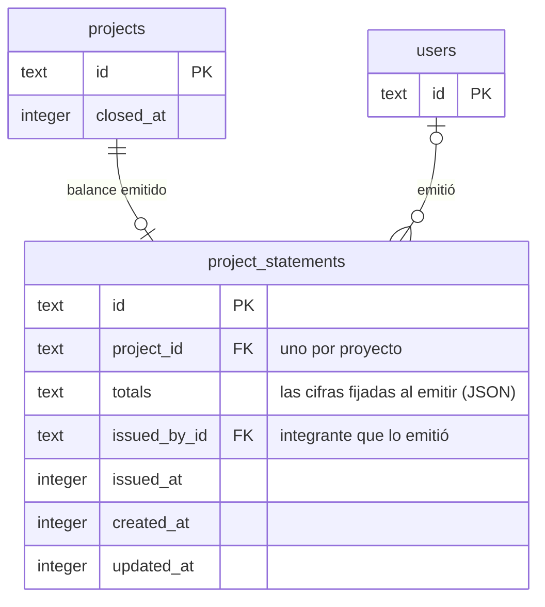

[← Volver al índice](README.md)

# Proyectos y quién cobró

Se agrupan las actividades en eventos y proyectos (la Chocolatada 2026 con su bingo, el mural, las cámaras) y se corrige quién cobró cada pago.

## Lo que hay

- **Actividades:**
  - Hay una sola, el Bingo II, creada por una migración. No hay pantalla para crear actividades.
  - Cada actividad tiene nombre, tipo (solo bingo), fecha y precio por cartilla. No pertenece a nada más grande.
- **Quién cobró:**
  - Cada pago ya guarda quién lo cobró, y el detalle de la cartilla lo muestra («cobró Thony»).
  - Pero no se elige: siempre queda el admin que tiene la sesión abierta, y un pago ya hecho no se puede corregir, solo eliminar.
  - Por eso los cobros que hizo la señora Francisca figuran a nombre de quien los registró.
- **Regla para manejar plata:** el servidor ya comprueba que el vendedor de una cartilla sea ADMIN o SUPERADMIN. La misma comprobación sirve para quién cobró.
- **Choque de nombre:** «Proyectos» también aparece en el pendiente del contenido público de Juveco. Son cosas distintas mientras no se decida mostrar algo de aquí al público.

## Lo que falta

- **Eventos y proyectos.** No existe dónde registrarlos:
  - ver sus actividades;
  - comparar lo recaudado contra la meta;
  - cerrarlos cuando terminan.
- **Elegir quién cobró** al registrar un pago, y poder corregirlo después sin eliminar el pago. Al corregirlo, el servidor tiene que exigir que sea ADMIN o SUPERADMIN, igual que con el vendedor.
- **Ubicar el bingo.** El Bingo II tiene que quedar dentro de la Chocolatada 2026.
- **Activo o cerrado.** La lista de actividades tiene que mostrar a qué proyecto pertenece cada una y si está abierto o cerrado.

## Lo que conlleva

### Entregable 1: eventos y proyectos

Al subirlo se pueden crear, editar y cerrar eventos y proyectos, y ver el Bingo II dentro de la Chocolatada 2026, con lo ganado hasta hoy contra la meta.

Campos de `projects`:
- `type`: evento (una fecha, como la Chocolatada) o proyecto (una obra, como el mural). Solo cambia cómo se llaman las fechas en pantalla.
- `name`: «Chocolatada 2026», «Ampliación de cámaras».
- `description`: para qué es, en una o dos líneas.
- `start_date`: la fecha del evento, o el inicio de la obra.
- `end_date`: hasta cuándo dura un evento de varios días, o la inauguración de una obra.
- `goal_amount`: cuánto se espera juntar. Sin meta, no se muestra el avance.
- `beneficiary_count`: a cuántos se atiende, como 400 niños. Sirve para proyectar el año siguiente.
- `closed_at`: cuándo se cerró. Vacío quiere decir que sigue abierto.

`activities.project_id` dice a qué proyecto pertenece la actividad. Es obligatorio si se aprueba la decisión 1 del índice.

**Avance contra la meta:** por ahora se calcula como la ganancia de sus actividades. Cuando lleguen los aportes y los gastos del proyecto (documentos 2 y 3), se suman y se restan ahí.

### Entregable 2: corregir quién cobró

Al subirlo, el formulario de pago trae «Cobrado por» con el admin de la sesión puesto, y se puede cambiar por otro ADMIN o SUPERADMIN.

Acordado el 2026-11-19:
- Se usa el mismo `POST` de pagos, con un `collectorId` opcional. No hay endpoint para editar.
- Un pago mal puesto, sea por el monto, el método o quién cobró, se elimina y se registra de nuevo. Así se corrigen los de la señora Francisca.
- En el formulario, el monto y el método van en una fila, con Yape y Efectivo como grupo de botones. Debajo va «Cobrado por».

No cambia la base: el campo ya existe.

### Entregable 3: previsualizar y emitir el balance (después de los documentos 2 y 3)

Propuesto el 2026-11-17, a partir de cómo lo hace Domus: ahí un periodo no se puede reabrir si ya tiene recibos emitidos.

Al subirlo, el proyecto tiene:
- **Previsualizar balance:** el balance tal como quedaría, sin fijarlo. Se puede ver con el proyecto abierto o cerrado.
- **Emitir balance:** solo con el proyecto cerrado. Fija las cifras de ese momento, con la fecha y el integrante que lo emitió.
- **Reabrir:** se puede mientras el balance no esté emitido. Una vez emitido, el proyecto ya no se reabre, para que las cifras entregadas no cambien.

Va después de los documentos 2 y 3 porque hoy el balance del proyecto solo suma lo ganado por sus actividades. Le faltan los gastos del proyecto y los aportes. Emitir un balance incompleto sería peor que no tenerlo.

Se guarda una copia de las cifras al emitir, y no solo la fecha. Si después se corrige un gasto por error, el balance entregado sigue diciendo lo que dijo ese día.

Mientras no exista este entregable, sigue lo acordado: cualquier admin cierra y solo el superadmin reabre.

### Pruebas

Qué se prueba

- Crear un evento y un proyecto. Las etiquetas de las fechas cambian según el tipo.
- El Bingo II aparece dentro de la Chocolatada 2026 y su ganancia coincide con la del resumen del bingo.
- Cerrar un proyecto: ya no deja registrar cartillas ni pagos en sus actividades. El superadmin lo reabre.
- Registrar un pago eligiendo a otro admin como «Cobrado por». El detalle muestra a esa persona.
- El servidor rechaza como «Cobrado por» a una persona con rol Usuario.
- Para corregir un pago antiguo, se elimina y se registra de nuevo con quien lo cobró.

## Riesgos

- **Cerrar un proyecto bloquea sus actividades.** Si la Chocolatada se cierra antes de terminar de cobrar el bingo, nadie podrá registrar los últimos pagos hasta que el superadmin la reabra.
- **Corregir quién cobró deja la caja del paso 3 sin historial.** Hoy no queda registro de quién hizo el cambio ni cuándo. Mientras no exista la caja no afecta nada; cuando exista, un cambio mal hecho mueve plata de una persona a otra sin dejar rastro.
