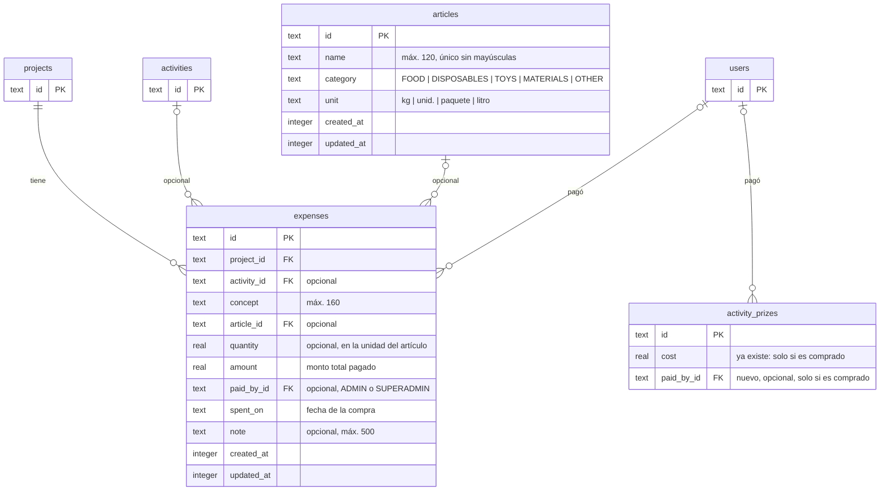

[← Volver al índice](README.md)

# Artículos y gastos

Las compras se registran con artículo, cantidad y monto, tanto las de una actividad como las del evento en sí. El balance las agrupa por artículo, para saber el próximo año cuánto se compró de cada cosa.

## Lo que hay

- **Gastos de una actividad:** solo concepto, monto y nota («Impresión de cartillas, S/ 60»). No hay gastos del evento fuera de una actividad.
- **Premios comprados:** guardan su costo en el mismo premio y el balance los resta aparte de los gastos.
- **Ganancia:** el balance del bingo, el resumen y la ganancia de la lista de cartillas leen esos gastos.

## Lo que falta

- **Gastos del proyecto.** Las compras de la Chocolatada que no son del bingo (cocoa, panetones, platos) no tienen dónde registrarse.
- **Artículo y cantidad.** Hoy un gasto es solo texto y monto. «Platos» y «platos descartables» son dos cosas distintas para el sistema, y no se puede sumar cuántos se compraron.
- **Un catálogo de artículos** con su categoría y su unidad, compartido con las donaciones de insumos (documento 3). Así lo donado y lo comprado se suman.
- **Quién pagó cada gasto y cada premio comprado**, para la caja del paso 3.
- **Gastos por artículo en el balance:** el total de cada artículo y, al desplegarlo, cada compra con su cantidad, su precio unitario y su fecha.

## Lo que conlleva

### Entregable 1: catálogo de artículos y gastos con artículo

Al subirlo, el proyecto tiene su sección de gastos, y los gastos del bingo pasan a verse ahí también, marcados con la actividad.

Cada gasto puede llevar:
- **un artículo**, que se elige del catálogo o se crea en el mismo formulario;
- **la cantidad** y **el monto total**, y el precio unitario se muestra calculado;
- **quién pagó**.

Un gasto sin artículo, como un pasaje, sigue funcionando con solo el concepto.

Campos de `articles`:
- `name`: «Cocoa», «Platos descartables». No se puede repetir, sin importar mayúsculas.
- `category`: para agrupar en el balance y en el inventario. Es una lista fija si se aprueba la decisión 5 del índice.
- `unit`: una sola por artículo. Si el azúcar viene en bolsas de 5 kg, se registra como 5 kg. Así las cantidades siempre se pueden sumar.

Campos de `expenses` (reemplaza a los gastos de actividad):
- `project_id`: el proyecto al que pertenece el gasto. Siempre lleva uno.
- `activity_id`: la actividad, si el gasto es de ella. Si va vacío, es un gasto del evento.
- `concept`: qué se pagó. Si hay artículo, se llena con su nombre y se puede cambiar.
- `article_id` y `quantity`: qué se compró y cuánto. Van juntos o no van.
- `amount`: lo que salió de la plata. Se guarda el total y no el precio unitario, porque el total es lo que cuadra con la caja; el unitario se calcula.
- `paid_by_id`: el integrante que pagó.
- `spent_on`: la fecha de la compra, que puede ser distinta del día en que se registró.

En `activity_prizes` se agrega `paid_by_id`: el integrante (ADMIN o SUPERADMIN) que pagó el premio comprado. Es opcional y solo se llena en los comprados. El formulario de premio lo pide junto al costo.

Detalle técnico: por qué una sola tabla de gastos

Se compararon tres formas:
- Agregar el proyecto a la tabla de gastos actual sin cambiarle el nombre. Es lo más barato, pero el nombre diría «gastos de actividad» cuando muchos no lo son.
- Crear una tabla nueva solo para los gastos del proyecto. No toca nada del bingo, pero cada reporte del evento tendría que juntar dos tablas, y cualquier cambio en los gastos (artículo, quién pagó) se haría dos veces.
- Una sola tabla `expenses` con la actividad opcional, pasando los gastos actuales con su actividad y el proyecto de esa actividad. Es la que se recomienda.

Esta última cuesta una migración de datos y actualizar el balance, el resumen y la ganancia de la lista de cartillas en el mismo entregable. A cambio, todo gasto se consulta igual, y es la misma forma que usan los aportes del documento 3: el proyecto siempre, la actividad opcional.

Los premios comprados no se mueven. Siguen guardando su costo en el premio, porque son un premio antes que un gasto, y el balance los sigue restando aparte.

### Pruebas

Qué se prueba

- Tras la migración, el balance, el resumen y la ganancia de la lista de cartillas del Bingo II muestran las mismas cifras que antes.
- Registrar dos compras de platos a distinto precio. El balance del proyecto muestra «Platos» con la suma de cantidades y montos y, al desplegarlo, las dos líneas con su precio unitario.
- Crear un artículo desde el formulario. Escribirlo de nuevo con otras mayúsculas no crea otro.
- Un gasto del bingo aparece en el bingo y en el proyecto. Un gasto del proyecto sin actividad aparece solo en el proyecto.
- El servidor rechaza un «pagado por» con rol Usuario y una cantidad sin artículo.
- Registrar un premio comprado con «pagado por». Un premio donado no lo acepta.

## Riesgos

- **Artículos casi repetidos.** «Azúcar» y «Azucar» o «Cocoa» y «Cocoa en polvo» no se detectan como iguales. Si el formulario no muestra los parecidos antes de crear uno nuevo, el inventario y la proyección se parten en dos.
- **La unidad equivocada.** Si alguien registra «1» en un artículo en kg pensando en una bolsa de 5 kg, la cantidad queda mal y nada lo detecta. La pantalla tiene que mostrar la unidad junto a la cantidad.
- **Cambiar el artículo de compras ya registradas.** Editar la unidad o la categoría de un artículo que ya tiene compras cambia lo que dicen esas compras. La unidad no debería poder cambiarse una vez usada.
