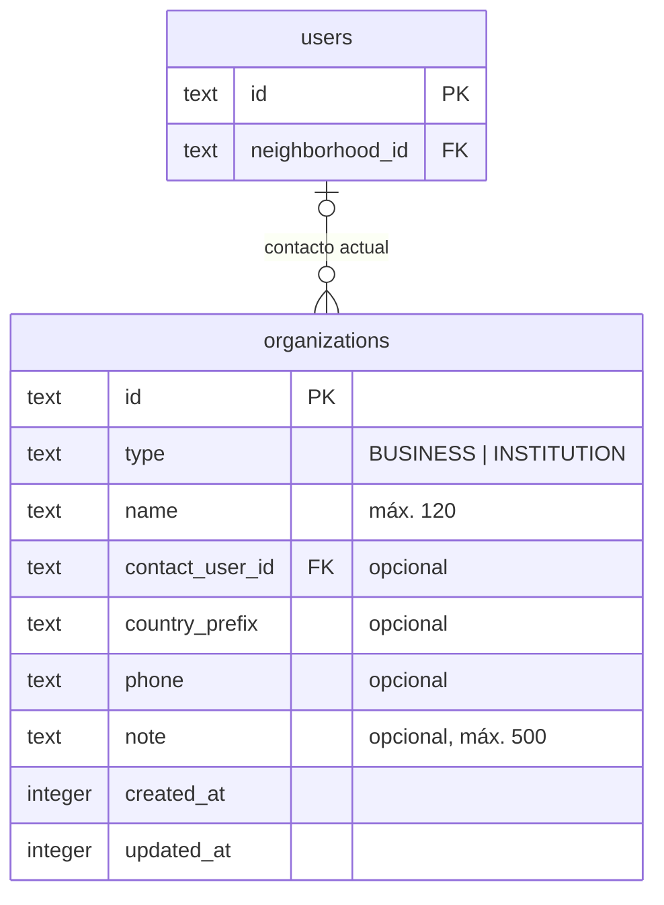
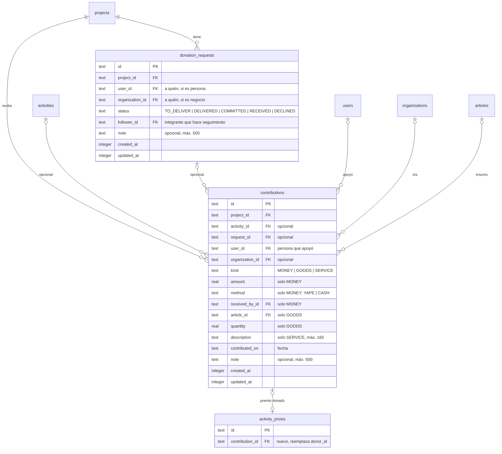

[← Volver al índice](README.md)

# Donantes, oficios y aportes

Se registra todo apoyo, sea para el evento o para una actividad, como los premios del bingo. Cada apoyo queda a nombre de quien lo dio. Los oficios se siguen por estado. Al final hay una sola lista de quiénes apoyaron cada proyecto.

## Lo que hay

- **Personas:** una sola tabla para todas, con barrio. Los negocios no existen: hoy el nombre del negocio se escribe en la nota del premio.
- **Premios donados:** guardan a la persona que donó, y a quien donó un premio no se le puede eliminar. Es el único registro de donantes que existe, y solo cubre premios del bingo.
- **Oficios:** no hay nada. No existen ni las donaciones de dinero o insumos para el evento ni el seguimiento de los oficios.

## Lo que falta

- **Negocios e instituciones:** una ficha con nombre, tipo, contacto actual y teléfono. Desde la ficha de la persona se tiene que ver «también apoya vía Bodega Rosita».
- **Aportes**, en un solo lugar para todo apoyo:
  - de dinero (monto, método y quién lo recibió);
  - de insumos (artículo y cantidad, sin valor);
  - de apoyo (mano de obra, préstamo de ollas).

  Cada uno va al proyecto o a una de sus actividades, con oficio o sin él.
- **Oficios:** a quién se dirige, en qué estado está y quién le hace seguimiento. Los estados son `Por entregar → Entregado → Comprometido → Recibido`, o `No apoyará`.
- **Ficha del donante:** su historial de aportes, con la suma de lo dado en dinero y la lista de insumos y apoyos.
- **Inventario del proyecto:** cuánto se recibió de cada artículo, sumado a lo comprado del documento 2.
- **Lista de quiénes apoyaron** el proyecto y sus actividades, que el admin puede abrir para ver el tipo y el monto de cada aporte.

## Lo que conlleva

### Entregable 1: negocios e instituciones

Al subirlo se pueden crear y editar negocios e instituciones, con su contacto elegido de entre las personas.

- `type`: negocio (una bodega, un taller) o institución (la parroquia, el colegio).
- `contact_user_id`: la persona de contacto de **hoy**. Si cambia de dueño, se cambia aquí, y los aportes anteriores no se mueven.
- `country_prefix` y `phone`: igual que en personas, con la misma validación.
- No lleva barrio. Los locales y el mapa quedan para después.

### Entregable 2: oficios y aportes

Al subirlo, cada proyecto tiene sus secciones de oficios y aportes, y cada donante, sea persona o negocio, tiene su historial.

Campos de `donation_requests` (oficios):
- `user_id` u `organization_id`: a quién se dirige. Va uno de los dos, nunca los dos.
- `status`: dónde está el oficio. Pasa a «Recibido» cuando se registra el primer aporte con ese oficio, y se puede cambiar a mano.
- `follower_id`: el integrante (ADMIN o SUPERADMIN) que lo entrega y le hace seguimiento.

Campos de `contributions` (aportes):
- `project_id` y `activity_id`: a qué se aportó. Lleva siempre el proyecto, y la actividad si el aporte es de ella, como un premio para el bingo.
- `request_id`: el oficio que lo originó. Va vacío si se pidió de palabra.
- `user_id` y `organization_id`: quién apoyó.
  - Si apoyó un negocio, va el negocio y la persona que estaba al frente ese día. La persona se copia del contacto al registrar y queda fija.
  - Una institución sin representante puede ir sin persona.
  - Al menos uno de los dos es obligatorio.
- `kind`: dinero, insumo o apoyo. Según el tipo se llenan unos campos u otros, y el servidor rechaza combinaciones que no corresponden.
- `amount`, `method` y `received_by_id`: cuánto se dio en dinero, por qué medio y qué integrante lo recibió. Lo usa la caja del paso 3.
- `article_id` y `quantity`: qué insumo y cuánto, con el mismo catálogo de las compras.
- `description`: qué apoyo se dio, como «Mano de obra el día de la venta» o «Préstamo de 2 ollas».
- `activity_prizes.contribution_id`: el premio donado apunta a su aporte, y deja de guardar al donante él mismo. Esto aplica si se aprueba la decisión 3 del índice.

Detalle técnico: por qué una sola tabla de aportes

Los tres tipos de aporte se piden, se agradecen y se listan igual. Solo cambia qué se guarda de cada uno. Tres tablas obligarían a juntarlas para la lista de reconocimiento y para la ficha del donante. Una sola tabla con campos que dependen del tipo deja esas pantallas en una sola consulta, y el servidor valida que cada tipo traiga lo suyo.

Para los premios donados se comparó dejarlos como están y que la lista de reconocimiento lea premios y aportes juntos. Funciona, pero un donante del bingo y uno del evento quedarían en lugares distintos, y su ficha tendría que mirar dos tablas para siempre. Convertirlos en aportes cuesta una migración de datos: un aporte de insumo por cada premio donado, con la persona que hoy tiene el premio. El nombre del negocio que hoy está en la nota del premio no se puede convertir solo; queda en la nota del aporte para corregirlo a mano.

### Entregable 3: inventario y lista de quiénes apoyaron

Al subirlo, el proyecto muestra:
- **Inventario:** por artículo, cuánto se donó, cuánto se compró y el total.
- **Quiénes apoyaron:** una línea por donante, «Bodega Rosita (Rosa Pérez)» o «Juan Pérez», con lo que dio al desplegarla.

No cambia la base.

### Pruebas

Qué se prueba

- Crear un negocio con contacto. En la ficha de la persona aparece «también apoya vía…».
- Cambiar el contacto del negocio. Los aportes anteriores siguen con la persona anterior y los nuevos llevan a la nueva.
- Crear un oficio, avanzar sus estados y registrar un aporte con ese oficio: el oficio pasa a «Recibido».
- Registrar un aporte sin oficio, de cada tipo. El servidor rechaza dinero sin monto, un insumo sin artículo o un aporte sin persona ni negocio.
- Tras la migración, los premios donados del bingo aparecen como aportes del bingo, con su donante, en la lista de quiénes apoyaron.
- El inventario suma «2 kg» y «1 kg» de azúcar donados con «5 kg» comprados: 8 kg.
- No se puede eliminar a una persona ni a un negocio con oficios o aportes. Sale el aviso en español.

## Riesgos

- **El nombre del negocio de los premios ya donados** está escrito en la nota, no en una ficha. Tras la migración, esos aportes quedan solo a nombre de la persona hasta que alguien les asigne el negocio a mano.
- **Donantes repetidos.** Si se crea «Bodega Rosita» y luego «Bodega Rosa» porque no se encontró la primera, el historial se parte en dos y no hay cómo juntarlos desde la app. El buscador tiene que mostrar los parecidos antes de crear uno nuevo.
- **Un aporte de dinero que no pasa por la caja.** Hasta que exista el paso 3, que alguien recibió S/ 50 queda guardado, pero no se ve en ningún saldo. Se puede leer como que esa plata no existe.
- **Cambiar el tipo de un aporte ya registrado** (de insumo a dinero) deja datos del tipo anterior si el servidor no los limpia al guardar.
